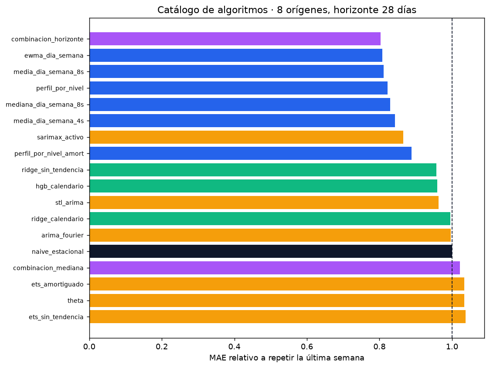
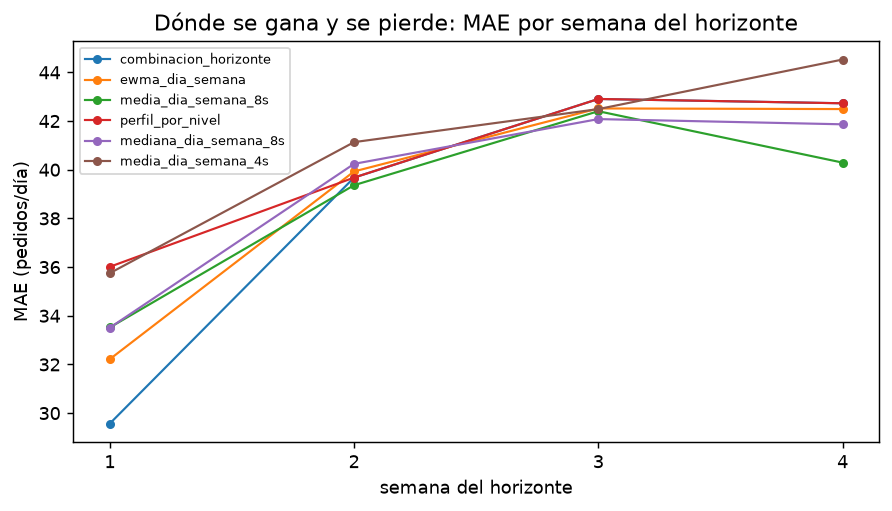
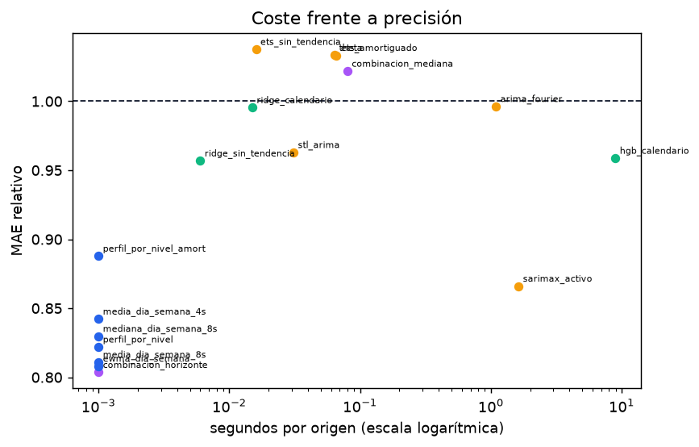

# Análisis de rendimiento y búsqueda de mejores algoritmos (componente 2)

**Ejecución:** 23 de noviembre de 2026.
**Pregunta:** [`evaluacion_demanda.md`](evaluacion_demanda.md) §11 dejó abierto que una media por día de la semana pronostica mejor que cualquier SARIMA probado. ¿Es un accidente de ese baseline concreto o hay toda una familia de métodos mejor para esta serie? ¿Y cuánto cuesta cada uno?
**Dictamen:** no es un accidente. **Los seis estimadores de perfil semanal probados baten al modelo activo**, con 3 a 4 pedidos/día menos de error y entre 1.000 y 1.800 veces menos coste de cómputo. Pero con ocho ventanas de prueba **la ventaja no alcanza significación estadística**: todos los intervalos de confianza al 95 % frente al modelo activo incluyen el cero. La recomendación de cambiar se apoya en la consistencia y en el coste, no en una diferencia demostrada.

Métricas íntegras: [`resultados_demanda_algoritmos/metricas.json`](resultados_demanda_algoritmos/metricas.json).

```bash
python -m ml.benchmark_demand            # 18 algoritmos + sensibilidad, ~85 s
python -m ml.benchmark_demand --solo rapidos
```

**El tramo reservado no se ha tocado.** Este banco usa solo los ocho orígenes de desarrollo; su cometido es ordenar candidatos, no certificar ninguno. Las cifras son comparables fila a fila con las de `evaluacion_demanda.md` porque comparten ventana, orígenes, horizonte y baseline.

---

## 1. De dónde sale el error

Antes de buscar algoritmos conviene saber qué falla. Descomponiendo el error cuadrático del modelo activo sobre los 224 días evaluados:

| Modelo | MSE | Sesgo² | Varianza |
|---|---:|---:|---:|
| SARIMA activo | 3.196 | 599 (**18,7 %**) | 2.609 |
| Media por día de semana | 3.023 | 119 (3,9 %) | 2.918 |
| Repetir la última semana | 4.189 | 2 (0,0 %) | 4.206 |

**El error del modelo activo es, en una quinta parte, error de nivel.** Y ese sesgo no es constante: crece con el horizonte.

| Sesgo medio (pedidos/día) | Semana 1 | Semana 2 | Semana 3 | Semana 4 |
|---|---:|---:|---:|---:|
| SARIMA activo | +1,5 | +29,4 | +31,4 | **+35,6** |
| Repetir la última semana | −9,3 | +6,5 | +4,5 | +3,6 |

El modelo extrapola la tendencia de crecimiento de 2017 más allá de donde se sostiene, y cada semana que pasa se aleja más. Los dos peores orígenes son los de mayo y junio de 2018 —cuando la demanda dejó de crecer— con errores de nivel de +80 y +45 pedidos/día.

Esto orienta la búsqueda hacia tres ideas: **amortiguar o eliminar la tendencia**, **separar el nivel de la forma semanal** y **combinar** métodos que fallan de forma distinta.

## 2. El catálogo

Dieciocho algoritmos en cinco familias, todos con las bibliotecas que el proyecto ya declara (statsmodels y scikit-learn). Sin dependencias nuevas.

| Familia | Qué prueba |
|---|---|
| **Baseline** | Repetir la última semana: lo que hace la aplicación sin modelo |
| **Perfil semanal** | Media, mediana y media exponencial por día de la semana; forma larga × nivel reciente; con deriva amortiguada |
| **Clásica** | Theta, Holt-Winters amortiguado y sin tendencia, STL + ARIMA, ARIMA con armónicos de Fourier, y el SARIMAX activo |
| **Aprendizaje** | Ridge y gradient boosting sobre rasgos de calendario, con y sin tendencia |
| **Combinación** | Mediana de tres familias; naive la primera semana y perfil después |

## 3. Resultados

Ocho ventanas de 28 días. `relMAE` = MAE relativo a repetir la última semana: por debajo de 1 el método aporta.

| Algoritmo | Familia | MAE | relMAE | Mediana | Gana a / 8 | Sesgo | s/origen |
|---|---|---:|---:|---:|---:|---:|---:|
| Naive la semana 1 + perfil después | combinación | **38,72** | **0,804** | 0,814 | **7** | +8,5 | 0,001 |
| Perfil con peso exponencial | perfil | 39,29 | 0,808 | 0,830 | 6 | +10,5 | 0,001 |
| Media por día de semana, 8 semanas | perfil | 38,90 | 0,811 | **0,721** | 6 | +16,6 | 0,001 |
| Forma semanal larga × nivel reciente | perfil | 40,33 | 0,822 | 0,815 | **7** | +10,9 | 0,001 |
| Mediana por día de semana | perfil | 39,42 | 0,830 | 0,745 | 5 | +17,8 | 0,001 |
| Media por día de semana, 4 semanas | perfil | 40,98 | 0,842 | 0,825 | 6 | +10,9 | 0,001 |
| **SARIMA(2,1,2)(1,1,1)[7] + calendario (activo)** | clásica | 42,68 | 0,866 | 0,846 | 5 | +24,5 | 1,807 |
| Perfil × nivel con deriva amortiguada | perfil | 42,98 | 0,888 | 0,902 | 6 | +8,4 | 0,001 |
| Ridge sobre calendario, sin tendencia | aprendizaje | 43,54 | 0,957 | 0,980 | 4 | +2,1 | 0,006 |
| Gradient boosting sobre calendario | aprendizaje | 45,63 | 0,959 | 0,872 | 5 | +12,9 | 7,261 |
| STL robusto + ARIMA(1,1,1) | clásica | 46,62 | 0,963 | 0,989 | 5 | +4,2 | 0,033 |
| Ridge sobre calendario con tendencia | aprendizaje | 46,91 | 0,995 | 1,005 | 4 | +34,7 | 0,014 |
| ARIMA(2,1,2) con armónicos de Fourier | clásica | 47,94 | 0,996 | 1,000 | 4 | −6,6 | 1,074 |
| *Repetir la última semana (baseline)* | baseline | 48,67 | 1,000 | 1,000 | 0 | +1,3 | 0,000 |
| Mediana de tres familias | combinación | 49,18 | 1,022 | 1,014 | 4 | −5,5 | 0,106 |
| Holt-Winters amortiguado | clásica | 49,63 | 1,033 | 1,031 | 3 | −6,6 | 0,070 |
| Método Theta | clásica | 49,75 | 1,033 | 1,036 | 3 | −5,4 | 0,063 |
| Holt-Winters sin tendencia | clásica | 49,71 | 1,038 | 1,035 | 3 | −7,9 | 0,017 |



Cuatro lecturas:

**La familia del perfil domina.** Sus seis variantes ocupan seis de los siete primeros puestos y todas baten al modelo activo salvo la amortiguada. El mejor método clásico distinto del SARIMAX activo —STL + ARIMA— queda en 0,963.

**Theta y Holt-Winters pierden contra repetir la última semana.** Es un resultado llamativo: Theta ganó la competición M3 y es la referencia obligada en pronóstico univariante. Aquí su desestacionalización suaviza justo lo que hay que conservar, el perfil semanal, y los tres métodos de suavizado acaban con sesgo negativo de −5 a −8 pedidos/día.

**Amortiguar no era la respuesta.** Era la hipótesis natural del §1 y el banco la refuta: el perfil con deriva amortiguada (0,888) empeora respecto al mismo perfil sin ella (0,822), y los Holt-Winters amortiguado y sin tendencia quedan empatados en 1,03. Lo que importa no es cómo se trata la tendencia, sino cuánta historia se usa para estimar la forma de la semana.

**La tendencia en los modelos de aprendizaje es veneno.** Ridge con tendencia: 0,995 y sesgo +34,7. El mismo modelo sin el término de tendencia: 0,957 y sesgo +2,1. El gradient boosting queda en 0,959 precisamente porque los árboles **no saben** extrapolar: esa limitación, que suele ser un defecto, aquí amortigua por construcción.

### Dónde se gana

| MAE por semana del horizonte | Semana 1 | Semana 2 | Semana 3 | Semana 4 |
|---|---:|---:|---:|---:|
| Repetir la última semana | **29,6** | 50,8 | 57,6 | 56,7 |
| SARIMA activo | 30,8 | 41,9 | 47,1 | 51,0 |
| Media por día de semana, 8 semanas | 33,5 | 39,4 | 42,4 | **40,3** |
| Naive la semana 1 + perfil después | **29,6** | 39,7 | 42,9 | 42,7 |

El baseline es **imbatible en la primera semana** —nadie mejora sus 29,6— y se desmorona a partir de la segunda. Los estimadores de perfil hacen lo contrario. De ahí la combinación por horizonte, que coge lo mejor de cada tramo.



## 4. ¿Son significativas las diferencias?

Bootstrap pareado **remuestreando orígenes**, no días: los 28 días de una misma ventana comparten el mismo estado de la serie y el mismo ajuste, y tratarlos como independientes estrecharía los intervalos de forma artificial. 5.000 réplicas, semilla 42; lo calcula el propio script.

| Comparación | Δ MAE | IC 95 % | P(es mejor) | ¿Significativo? |
|---|---:|---:|---:|---|
| **Frente al baseline** | | | | |
| Naive + perfil | −9,94 | [−17,09, −3,76] | 1,000 | **sí** |
| Media por día de semana, 8 semanas | −9,77 | [−17,25, −1,97] | 0,994 | **sí** |
| Perfil con peso exponencial | −9,38 | [−15,64, −3,32] | 1,000 | **sí** |
| Forma × nivel | −8,33 | [−12,74, −3,66] | 0,999 | **sí** |
| SARIMA activo | −5,99 | [−11,22, −0,58] | 0,986 | **sí** |
| Ridge sin tendencia | −5,13 | [−16,06, +4,57] | 0,822 | no |
| Gradient boosting | −3,04 | [−8,69, +2,98] | 0,849 | no |
| STL + ARIMA | −2,04 | [−5,63, +1,26] | 0,871 | no |
| Theta | +1,08 | [−3,11, +4,93] | 0,285 | no |
| **Frente al modelo activo** | | | | |
| Media por día de semana, 8 semanas | −3,78 | [−9,52, **+0,07**] | 0,971 | no |
| Naive + perfil | −3,96 | [−9,66, **+1,66**] | 0,911 | no |
| Perfil con peso exponencial | −3,39 | [−7,03, **+0,39**] | 0,958 | no |
| Mediana por día de semana | −3,25 | [−9,93, **+1,29**] | 0,868 | no |
| Forma × nivel | −2,35 | [−6,12, **+1,32**] | 0,888 | no |
| **Entre los mejores** | | | | |
| Naive + perfil vs media 8 semanas | −0,17 | [−5,33, +5,03] | 0,514 | no |
| Naive + perfil vs perfil exponencial | −0,57 | [−3,05, +2,28] | 0,670 | no |
| Naive + perfil vs forma × nivel | −1,61 | [−5,21, +1,49] | 0,815 | no |

Tres conclusiones que conviene no confundir:

1. **La familia del perfil bate al baseline con significación; la clásica y la de aprendizaje, no.** Los cinco estimadores de perfil y el SARIMAX activo tienen el intervalo entero por debajo de cero. Ridge, gradient boosting, STL + ARIMA y Theta no: su ventaja aparente sobre repetir la última semana no se distingue del azar.
2. **Ninguno bate al modelo activo con significación.** Los intervalos incluyen el cero por muy poco —la media por día de semana se queda en +0,07— pero lo incluyen. Con ocho ventanas no da para más.
3. **Entre los mejores, elegir es tirar una moneda.** La diferencia entre el primero y el tercero es de 0,17 pedidos/día con P = 0,514. Cualquier ranking dentro de ese grupo es ruido, y quedarse con el número uno sería optimizar contra este mismo banco.

## 5. ¿Depende de acertar un parámetro?

Una ventaja que solo existe en un punto de la rejilla no es una ventaja. Se recorre el espacio de cada familia:

| Familia | Mejor | Peor | Mediana | Puntos por debajo de 0,90 |
|---|---:|---:|---:|---|
| Forma × nivel (5 × 5 combinaciones) | 0,796 | 0,982 | 0,850 | **19 de 25** |
| Media por día de semana (8 ventanas) | 0,809 | 0,962 | 0,830 | **6 de 8** |
| Perfil exponencial (5 valores de α) | 0,792 | 0,907 | 0,808 | **4 de 5** |

La región buena es ancha. El mensaje es consistente en las tres parametrizaciones: **cuanta más historia se use para la forma semanal, mejor**, hasta saturar alrededor de las 8-16 semanas. Las ventanas cortas son las que fallan: 2 y 3 semanas dan 0,94 y 0,96.

Esto también explica por qué el `media_dia_semana` de 4 semanas del informe anterior (0,842) se quedaba corto: no era el techo de su familia, sino un punto mediocre de ella.

## 6. Coste

| Algoritmo | Segundos por origen | Veces el coste del perfil |
|---|---:|---:|
| Estimadores de perfil | 0,001 | 1× |
| Theta, Holt-Winters, STL | 0,02 – 0,07 | 20 – 70× |
| ARIMA con Fourier | 1,07 | ~1.000× |
| **SARIMA activo** | **1,81** | **~1.800×** |
| Gradient boosting | 7,26 | ~7.000× |

A eso hay que sumarle lo que cuesta *elegir* un SARIMAX: la búsqueda de especificación recorre 288 ajustes y tarda unos 20 minutos, frente a los 85 segundos del catálogo entero. Y el SARIMAX arrastra un optimizador que puede no converger, un artefacto atado a la versión de statsmodels y una reconstrucción con `smooth(params)` en cada arranque del backend; un estimador de perfil es una media agrupada.



## 7. Por qué falla aquí lo que suele funcionar

La serie tiene tres rasgos que explican el orden de la tabla:

1. **La estacionalidad semanal es el 90 % de la señal y es muy estable.** Lo que distingue a un buen método es cuánta historia usa para estimar ese perfil, no cómo modela la dinámica. Theta y STL desestacionalizan para modelar el resto, y el resto aquí apenas tiene estructura aprovechable.
2. **El nivel cambia a saltos, no con tendencia suave.** Olist crece durante 2017, se estanca en la primera mitad de 2018 y sube un 40 % en agosto. Cualquier método que ajuste una pendiente y la proyecte se equivoca sistemáticamente; por eso el sesgo del SARIMAX crece de +1,5 a +35,6 según se aleja.
3. **Dieciocho meses son pocos.** No hay dos ciclos anuales, y los modelos con más parámetros —SARIMAX con 8, gradient boosting con cientos— no tienen datos para estimarlos mejor de lo que una media agrupada estima siete números.

## 8. Recomendación

**Sustituir el pronosticador puntual por un estimador de perfil semanal**, y hacerlo por el coste y la simplicidad tanto como por la precisión:

- Mejora consistente de 3 a 4 pedidos/día (del 7 al 9 % del error), en seis variantes independientes y en una región ancha de parámetros.
- Entre 1.000 y 1.800 veces más barato, sin optimizador, sin avisos de convergencia y sin un artefacto atado a la versión de la librería.
- Explicable en una frase a quien va a usarlo: *la demanda de cada día se estima con la media de ese mismo día de la semana en las últimas ocho semanas*.

**Cuál**: `perfil_por_nivel` (forma semanal de 12 semanas × nivel de los últimos 28 días). No es el primero de la tabla, y esa es exactamente la razón: entre los cinco primeros las diferencias son ruido (§4), así que conviene elegir por criterios que no dependan de este banco. Gana en 7 de 8 orígenes —el mejor registro, junto con la combinación—, tiene la menor dispersión entre ventanas (sd 0,14), separa de forma explícita las dos cosas que el §1 identificó como el problema, y sus parámetros se fijaron antes de medir, no después.

**Qué no cambia:** la banda. La calibración empírica por bloques del horizonte es **independiente del modelo** —se construye con los errores que comete, sean de donde sean—, así que ya sirve para cualquier pronosticador. Es el trabajo que hace barato este cambio.

**Qué haría falta:** enseñar al backend una familia de modelo nueva en `demand_model.py` (el artefacto guardaría el perfil y la ventana de nivel en vez de los parámetros de SARIMAX), sus pruebas, y volver a medir el tramo reservado con el modelo nuevo. Unas 100 líneas y una tarde.

**Qué no recomiendo:** quedarse con `combinacion_horizonte` aunque encabece la tabla. Su punto de corte —cambiar de método en el día 7— salió de mirar estos mismos ocho orígenes, es el candidato con más riesgo de estar ajustado al banco, y es estadísticamente indistinguible de alternativas sin ningún parámetro elegido a posteriori.

## 9. Limitaciones

1. **Ocho ventanas no dan para demostrar diferencias de este tamaño.** Es la limitación que domina todo el documento. Un banco con más orígenes exige una serie más larga, y la ventana útil de Olist son 591 días.
2. **El catálogo no es exhaustivo.** Faltan modelos jerárquicos, espacio de estados con cambio de régimen, y las bibliotecas especializadas de pronóstico (`statsforecast`, `prophet`), descartadas por no añadir dependencias al proyecto.
3. **Todo se midió a horizonte de 28 días.** La API ofrece hasta 90, y el orden de la tabla podría cambiar en horizontes largos, donde el perfil semanal se queda sin información sobre el nivel futuro.
4. **Los valores de los parámetros que aparecen en §5 se recorrieron sobre el banco.** Sirven para enseñar que la región buena es ancha, no para elegir el punto óptimo: hacer eso sería optimizar contra el propio banco.
5. **El tramo reservado sigue sin usarse aquí**, de modo que ningún número de este documento es una estimación limpia del error que cometería el método en producción. Esa confirmación es parte del trabajo de sustituirlo.
