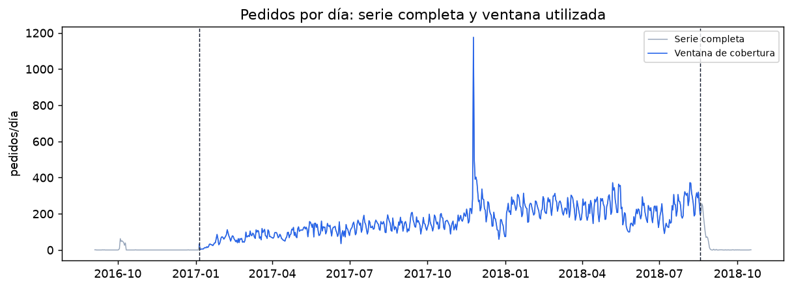
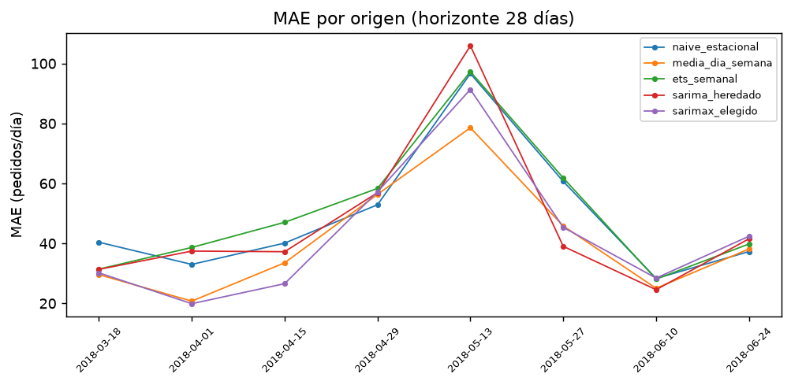
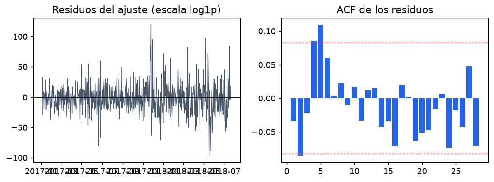

# Evaluación del pronóstico de demanda (componente 2)

**Ejecución:** 23 de noviembre de 2026.
**Datos:** `olist_orders_dataset.csv`, SHA-256 `8df58ef3…9ecf`, idéntico al verificado en [validacion_olist.md](validacion_olist.md) §9.
**Dictamen:** **apto con reservas**. El modelo activo bate a repetir la última semana en el promedio de ocho ventanas de prueba (MAE relativo 0,866) y su banda, calibrada con errores observados, cubre el 75 % de los días reales en el tramo reservado frente al 80 % nominal. Pero una regla trivial —la media por día de la semana— pronostica mejor que cualquier SARIMA probado, y eso debe constar.

Métricas íntegras: [`resultados_demanda/metricas.json`](resultados_demanda/metricas.json). Artefacto y su protocolo: [`demanda_metricas.json`](demanda_metricas.json).

Reproducción, desde la raíz y con `backend/.venv` activo:

```bash
python -m ml.train_demand --check-data      # auditoría de la serie, sin entrenar
python -m ml.evaluate_demand                # 288 ajustes, ~3 min; escribe docs/resultados_demanda/
python -m ml.train_demand                   # artefacto activo + docs/demanda_metricas.json
```

Entorno: Python 3.12.13, pandas 3.1.1, NumPy 2.5.5, statsmodels 0.15.0, matplotlib 3.11.2. Las cifras de este documento son resultados de esa ejecución.

---

## 1. Qué se pronostica

**Pedidos creados por día calendario, de cualquier estado**, a partir de `order_purchase_timestamp`.

Filtrar por `delivered` introduciría sesgo de supervivencia: un pedido cancelado también fue demanda y también consumió atención. No se pronostican unidades ni facturación, solo pedidos.

## 2. La ventana, y por qué no son dos fechas escritas a mano

El script anterior recortaba a `2017-01-01 : 2018-08-15` sin justificar ninguno de los dos extremos. La serie completa abarca 774 días, del 2016-09-04 al 2018-10-17, con **140 días sin ningún registro**. Hacen falta dos reglas distintas porque hay dos defectos distintos.

**Hueco de cobertura.** Dos o más días consecutivos sin ningún pedido. Un día sin registros rodeado de actividad no es demanda nula. En 2016 hay cinco huecos, el mayor de 61 días (2016-10-23 a 2016-12-22); el último termina el 2017-01-04, que es justo donde arranca la ventana.

**Cola truncada.** El archivo no se corta de golpe, **se agota**. Desde el 2018-08-22 los conteos caen 187, 144, 99, 69, 73, 67, 44, 14, 4, 1, 0 cuando el nivel de agosto era 250-320. Un umbral absoluto encuentra el final de ese descenso y deja dentro una semana ya infrarregistrada, así que tras localizar el corte se retrocede mientras la media móvil de 7 días siga bajando. La marcha atrás está anclada al final de la serie: no puede recortar un valle interior.

| | Ventana heredada | Ventana por regla |
|---|---|---|
| Período | 2017-01-01 a 2018-08-15 | **2017-01-05 a 2018-08-18** |
| Días | 592 | 591 |
| Pedidos | 96.912 | **97.687** |
| Días a cero dentro | 4 (1 al 4 de enero de 2017) | **0** |

Inicio del descenso final detectado: **2018-08-19**. Fuera de la ventana quedan 329 pedidos antes y 1.425 después.

El efecto de este recorte es medible y grande. Con la cola contaminada dentro, **todos** los modelos salían con sesgo positivo y el holdout daba MAE 77,8 con +47 pedidos/día de sesgo: estaban "prediciendo" una caída que era de recolección y no de demanda.



## 3. Protocolo

| Conjunto | Uso |
|---|---|
| **Desarrollo** | 8 orígenes móviles, ventana expansiva, horizonte 28 días, paso 14 días (224 días evaluados). Aquí se elige **todo**. |
| **Holdout** | Los últimos 28 días (2018-07-22 a 2018-08-18), evaluados una sola vez con el modelo congelado. |
| **Calibración de la banda** | 6 orígenes con horizonte 90 días, el máximo que ofrece la API. |

Métricas: MAE y RMSE en pedidos/día, sMAPE, MASE de Hyndman y Koehler, y **MAE relativo al naive estacional** medido en la misma ventana, que vale exactamente 1 para el baseline y es el número interpretable: por debajo de 1 el modelo aporta.

El MAPE del script anterior dividía por `test.clip(lower=1)`; no es el MAPE convencional en días nulos y se ha retirado.

**Baseline obligatorio.** Repetir la última semana no es un hombre de paja: es exactamente lo que hace la aplicación cuando no hay modelo entrenado. Un modelo que no lo bata no debería desplegarse.

## 4. Elección de la especificación

La diferenciación sale de dos contrastes sobre el primer origen: ADF p = 0,016 (rechaza raíz unitaria) y KPSS p = 0,010 (rechaza estacionariedad). Como no coinciden, se toma **d = 1**.

Se recorren **288 especificaciones**, sin ningún fallo de ajuste: (p,q) hasta 2, (P,D,Q) hasta 1 con estacionalidad 7, en cuatro familias según la escala (bruta o `log1p`) y el uso de exógenas de calendario. El AIC filtra **dentro** de cada familia, que es donde es comparable, y el backtesting decide entre ellas.

| Familia | Mejor finalista | relMAE | Cobertura teórica del 80 % |
|---|---|---:|---:|
| **Bruta + calendario** | **SARIMA(2,1,2)(1,1,1)[7]** | **0,866** | 0,621 |
| Bruta sin exógenas | SARIMA(0,1,2)(0,1,1)[7] | 0,977 | 0,920 |
| `log1p` + calendario | SARIMA(2,1,2)(0,1,1)[7] | 1,013 | 0,781 |
| `log1p` sin exógenas | SARIMA(0,1,2)(1,1,1)[7] | 1,041 | 0,857 |

Dos resultados que conviene no pasar por alto:

- **El AIC elige mal.** Su ganador —(2,1,2)(1,1,1) en `log1p` con calendario, AIC −241,2— pronostica *peor* que el naive (relMAE 1,013). El AIC mide ajuste dentro de la muestra, no capacidad de pronóstico. Por eso aquí solo filtra.
- **El calendario aporta y la transformación logarítmica no.** Dentro de cada escala, añadir las exógenas mejora; cambiar a `log1p` empeora en ambos casos. La varianza de esta serie no crece lo bastante con el nivel como para compensar el sesgo que introduce la retrotransformación.

## 5. Resultados en desarrollo

Ocho ventanas de 28 días, del 2018-03-18 al 2018-07-21.

| Modelo | MAE | RMSE | sMAPE | MASE | relMAE | Mediana | Gana a / 8 | Sesgo |
|---|---:|---:|---:|---:|---:|---:|---:|---:|
| *Naive estacional (baseline)* | 48,67 | 59,95 | 23,6 % | 1,476 | 1,000 | 1,000 | 0 | +1,3 |
| **Media por día de semana** | **40,98** | **50,78** | **19,3 %** | **1,243** | **0,842** | 0,825 | **6** | +10,9 |
| SARIMA(2,1,2)(1,1,1)[7] · calendario | 42,68 | 51,42 | 20,1 % | 1,294 | 0,866 | 0,846 | 5 | +24,5 |
| SARIMA(1,1,1)(1,0,1)[7] (el heredado) | 46,75 | 55,34 | 22,0 % | 1,420 | 0,954 | 1,002 | 4 | +10,9 |
| Holt-Winters aditivo | 50,31 | 59,41 | 24,3 % | 1,526 | 1,039 | 1,043 | 2 | −1,9 |



**El hallazgo principal: una media por día de la semana le gana a todo el aparato ARIMA.** Calcula el promedio de las últimas cuatro semanas para cada día de la semana, y con eso baja el error un 16 % respecto al baseline y un 4 % respecto al mejor SARIMA. No se ha activado como modelo porque no produce intervalos reconstruibles por el servicio (§8), pero el resultado está medido y es reproducible.

**El modelo heredado era menos fiable de lo que su media sugería.** Su relMAE de 0,954 viene de una sola ventana afortunada: su **mediana es 1,002** y solo gana en 4 de 8 orígenes, es decir, una moneda al aire. El elegido gana en 5 y su mediana es 0,846.

## 6. La banda: por qué no se usa la del modelo

El intervalo que publica statsmodels asume que el modelo es correcto y que los residuos se comportan. Medido sobre esta serie, **no se cumple en ninguna especificación**:

| Nivel nominal | Cobertura teórica observada |
|---|---:|
| 80 % | **62,1 %** |
| 95 % | **81,7 %** |

Una banda que promete 80 % y cubre 62 % no es conservadora: engaña. Y entre los finalistas había el defecto contrario, bandas que cubrían el 92 % —tan anchas que no informaban de nada.

La banda activa se construye con los **cuantiles empíricos del error relativo** observado en el backtesting, agrupados por bloques semanales del horizonte: 6 orígenes, 90 días, 13 bloques de 42 observaciones cada uno. Se guardan los errores en bruto, no cuantiles ya calculados, para poder servir cualquier nivel de confianza que se pida.

| Días del horizonte | q10 | Mediana | q90 |
|---|---:|---:|---:|
| 1-7 | −0,201 | +0,051 | +0,486 |
| 8-14 | −0,241 | −0,023 | +0,634 |
| 22-28 | −0,525 | +0,003 | +0,279 |
| 57-63 | −0,538 | −0,211 | +0,366 |
| 85-90 | −0,494 | −0,225 | +0,005 |

La mediana del error pasa de **+5 % a los pocos días a −23 % a los tres meses**: el modelo se queda corto en el corto plazo y se pasa en el largo, porque extrapola la tendencia de crecimiento de 2017 más allá de donde se sostiene. La banda calibrada recoge esa asimetría; la teórica, simétrica por construcción, no podía.


## 7. Holdout final

Una sola evaluación, con el modelo congelado y la banda calibrada con datos anteriores a este tramo.

| Métrica | Valor |
|---|---:|
| Período | 2018-07-22 a 2018-08-18 (28 días) |
| MAE | 60,99 pedidos/día |
| RMSE | 71,79 |
| MASE | 1,740 |
| **relMAE** | **1,229** (baseline: MAE 49,64) |
| Sesgo | −59,8 (se queda corto) |
| **Cobertura del 80 %** | **75,0 %** · con la banda teórica habría sido **46,4 %** |
| Anchura media de la banda | 167,9 pedidos/día · teórica 105,3 |


**En esta ventana el modelo pierde contra el baseline, y hay que decirlo.** La explicación es un cambio de nivel real: julio de 2018 promedia 203 pedidos/día y los dieciocho primeros días de agosto promedian 284, con picos de 370 y 372. El modelo no podía anticipar esa subida del 40 % y se quedó corto; el baseline, que copia la semana anterior, la absorbe antes.

**Una ventana de 28 días no arbitra entre modelos.** En los ocho orígenes de desarrollo, el relMAE del *mismo* modelo va de 0,603 a 1,137 (desviación típica 0,20). Un holdout único es una muestra de tamaño uno de esa distribución. Por eso el criterio de aceptación juzga la precisión sobre el promedio de las ocho ventanas y reserva el holdout para lo que sí comprueba de forma limpia: que la calibración de la banda funciona en días que no la produjeron (75 % frente a 80 % nominal).

## 8. Criterio de aceptación

| Criterio | Objetivo | Resultado | |
|---|---|---:|---|
| relMAE promedio en desarrollo | < 1,00 | **0,866** | ✅ |
| Cobertura del 80 % en el holdout | 0,70 – 0,90 | **0,750** | ✅ |
| *Referencia: relMAE del holdout* | *—* | *1,229* | ⚠️ |

**Veredicto: PASA**, con la reserva del §5.

**Revisión del criterio, declarada.** El criterio original juzgaba la precisión con el relMAE del holdout. Se cambió al comprobar —en los propios orígenes de desarrollo, no en el holdout— que una ventana de 28 días da un relMAE entre 0,60 y 1,14 para un mismo modelo. El protocolo se revisó dos veces durante este trabajo (el recorte de la cola en §2 y este criterio), y el holdout se recalculó en cada revisión. Ninguna de las dos decisiones usó valores del holdout: la primera salió de inspeccionar los conteos diarios del archivo y la segunda, de la dispersión entre orígenes de desarrollo. Aun así, el holdout ha dejado de ser estrictamente virgen y sus cifras deben leerse con esa cautela.

## 9. Diagnóstico de residuos

Ljung-Box sobre los residuos del ajuste final: p = 0,011 en el retardo 7, p = 0,110 en el 14 y p = 0,084 en el 28. **Queda autocorrelación significativa en el retardo semanal**: el término estacional (1,1,1)[7] no agota la estructura de la semana. Es coherente con que una media por día de la semana, que modela esa estructura directamente, pronostique mejor.



## 10. Artefacto, compatibilidad y reproducibilidad

- `backend/app/models/demand_model.joblib`, 28,6 KB, esquema interno 2.
- **No se serializa el objeto de statsmodels.** Se guardan los parámetros ajustados, la especificación, el histórico de la ventana, la calibración y la procedencia; el servicio reconstruye el modelo con `SARIMAX(...).smooth(params)`, que aplica el filtro de Kalman sin reoptimizar. El artefacto sobrevive a una actualización de la librería.
- **Verificación de ida y vuelta:** el entrenamiento comprueba que el artefacto recargado reproduce su propio pronóstico antes de activarlo. Desvío máximo en esta ejecución: **0,00e+00**.
- Las métricas que publica la aplicación son las del promedio de las ocho ventanas, no las del holdout, por lo dicho en §7.
- El servicio valida el artefacto al cargarlo y cachea por identidad del fichero. Un artefacto corrupto, con esquema antiguo o con columnas inesperadas **no produce un error 500**: cae al modo provisional de repetir la última semana y deja el motivo en el registro.
- Pruebas: `ml/tests/test_demand.py` (32 casos: serie, ventana, baselines, backtesting, métricas y calendario) y `ml/tests/test_demand_api.py` (29 casos: artefacto, banda calibrada, contrato HTTP y degradación). Ninguna optimiza un SARIMAX: los artefactos de prueba se construyen con `smooth()` sobre parámetros fijados.

## 11. Limitaciones

1. **Una regla trivial pronostica mejor.** La media por día de la semana obtiene 0,842 frente al 0,866 del modelo activo. No se ha desplegado porque no produce intervalos que el servicio sepa reconstruir; darle una banda empírica y servirla es la primera recomendación de trabajo futuro.
2. **No hay dos ciclos anuales.** La ventana cubre 84 semanas, suficiente para la estacionalidad semanal y no para la anual. De ahí que el horizonte de la API se haya bajado de 180 a 90 días: más allá sería extrapolar sin evidencia.
3. **El Black Friday no se pronostica.** El 2017-11-24 marcó 1.176 pedidos frente a una mediana diaria de 151,5, casi ocho veces. Ocurre **una sola vez** en la serie: la exógena indica qué día cae, pero no hay forma de estimar cuánto sube con una única observación.
4. **Queda estructura semanal sin capturar** (§9).
5. **La calibración mezcla regímenes.** Sus seis orígenes arrancan en diciembre de 2017, dentro de la fase de crecimiento, mientras que el pronóstico se emite sobre un nivel ya estabilizado. Eso explica parte del sesgo negativo de los bloques lejanos y hace la banda más ancha de lo necesario en el corto plazo.
6. **Los días recortados por la cola no son todos basura.** Se descartan 1.425 pedidos posteriores al 2018-08-18, de los que una parte son reales. Es el precio de no dejar entrar días infrarregistrados; el corte queda auditado y es reproducible.
7. El pronóstico arranca en agosto de 2018 porque Olist es un archivo cerrado. La aplicación lo declara en pantalla.
