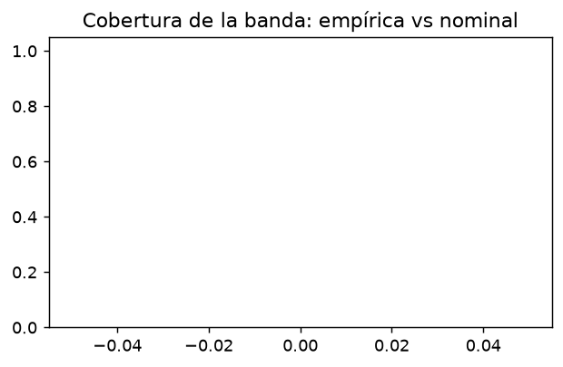
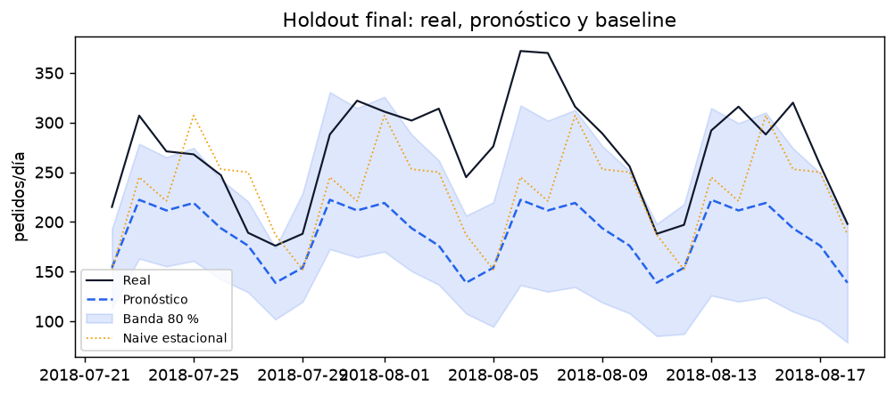

# Evaluación del pronóstico de demanda (componente 2)

**Ejecución:** 23 de noviembre de 2026.
**Datos:** `olist_orders_dataset.csv`, SHA-256 `8df58ef3…9ecf`, idéntico al verificado en [validacion_olist.md](validacion_olist.md) §9.
**Dictamen:** **apto con reservas**. El modelo activo —un estimador de perfil semanal— bate a repetir la última semana en siete de las ocho ventanas de prueba (MAE relativo 0,822) y su banda calibrada cubre el 86 % de los días reales en esas ventanas, frente al 80 % nominal. **No pasa el criterio de aceptación completo**: en el tramo reservado la cobertura cae al 32 %, porque esa ventana contiene un salto de nivel del +44 % que no tiene precedente en los datos de calibración. El apartado 7 lo explica con números y el 11 dice qué haría falta para cerrarlo.

> **Cambio de modelo, 23 de noviembre de 2026.** Hasta esta revisión el modelo activo era un SARIMAX. El banco de dieciocho algoritmos de [algoritmos_demanda.md](algoritmos_demanda.md) midió que los estimadores de perfil semanal pronostican mejor y cuestan tres órdenes de magnitud menos, y el protocolo de este documento —al incorporarlos como candidatos— los elige. Las cifras del SARIMAX se conservan en las tablas como término de comparación.

Métricas íntegras: [`resultados_demanda/metricas.json`](resultados_demanda/metricas.json). Artefacto y su protocolo: [`demanda_metricas.json`](demanda_metricas.json).

Reproducción, desde la raíz y con `backend/.venv` activo:

```bash
python -m ml.train_demand --check-data      # auditoría de la serie, sin entrenar
python -m ml.evaluate_demand                # 288 ajustes, ~3 min; escribe docs/resultados_demanda/
python -m ml.train_demand                   # artefacto activo + docs/demanda_metricas.json
```

Entorno: Python 3.12.13, pandas 3.1.1, NumPy 2.5.5, statsmodels 0.15.0, matplotlib 3.11.2. Las cifras de este documento son resultados de esa ejecución.

---

## 1. Qué se pronostica

**Pedidos creados por día calendario, de cualquier estado**, a partir de `order_purchase_timestamp`.

Filtrar por `delivered` introduciría sesgo de supervivencia: un pedido cancelado también fue demanda y también consumió atención. No se pronostican unidades ni facturación, solo pedidos.

## 2. La ventana, y por qué no son dos fechas escritas a mano

El script anterior recortaba a `2017-01-01 : 2018-08-15` sin justificar ninguno de los dos extremos. La serie completa abarca 774 días, del 2016-09-04 al 2018-10-17, con **140 días sin ningún registro**. Hacen falta dos reglas distintas porque hay dos defectos distintos.

**Hueco de cobertura.** Dos o más días consecutivos sin ningún pedido. Un día sin registros rodeado de actividad no es demanda nula. En 2016 hay cinco huecos, el mayor de 61 días (2016-10-23 a 2016-12-22); el último termina el 2017-01-04, que es justo donde arranca la ventana.

**Cola truncada.** El archivo no se corta de golpe, **se agota**. Desde el 2018-08-22 los conteos caen 187, 144, 99, 69, 73, 67, 44, 14, 4, 1, 0 cuando el nivel de agosto era 250-320. Un umbral absoluto encuentra el final de ese descenso y deja dentro una semana ya infrarregistrada, así que tras localizar el corte se retrocede mientras la media móvil de 7 días siga bajando. La marcha atrás está anclada al final de la serie: no puede recortar un valle interior.

| | Ventana heredada | Ventana por regla |
|---|---|---|
| Período | 2017-01-01 a 2018-08-15 | **2017-01-05 a 2018-08-18** |
| Días | 592 | 591 |
| Pedidos | 96.912 | **97.687** |
| Días a cero dentro | 4 (1 al 4 de enero de 2017) | **0** |

Inicio del descenso final detectado: **2018-08-19**. Fuera de la ventana quedan 329 pedidos antes y 1.425 después.

El efecto de este recorte es medible y grande. Con la cola contaminada dentro, **todos** los modelos salían con sesgo positivo y el holdout daba MAE 77,8 con +47 pedidos/día de sesgo: estaban "prediciendo" una caída que era de recolección y no de demanda.


## 3. Protocolo

| Conjunto | Uso |
|---|---|
| **Desarrollo** | 8 orígenes móviles, ventana expansiva, horizonte 28 días, paso 14 días (224 días evaluados). Aquí se elige **todo**. |
| **Holdout** | Los últimos 28 días (2018-07-22 a 2018-08-18), evaluados una sola vez con el modelo congelado. |
| **Calibración de la banda** | 6 orígenes con horizonte 90 días, el máximo que ofrece la API. |

Métricas: MAE y RMSE en pedidos/día, sMAPE, MASE de Hyndman y Koehler, y **MAE relativo al naive estacional** medido en la misma ventana, que vale exactamente 1 para el baseline y es el número interpretable: por debajo de 1 el modelo aporta.

El MAPE del script anterior dividía por `test.clip(lower=1)`; no es el MAPE convencional en días nulos y se ha retirado.

**Baseline obligatorio.** Repetir la última semana no es un hombre de paja: es exactamente lo que hace la aplicación cuando no hay modelo entrenado. Un modelo que no lo bata no debería desplegarse.

## 4. Elección del modelo

Compiten tres candidatos **servibles**, es decir, que el backend sabe reconstruir desde el artefacto:

- **SARIMAX**, con su especificación elegida recorriendo **288 combinaciones** sin ningún fallo de ajuste: (p,q) hasta 2, (P,D,Q) hasta 1 con estacionalidad 7, en cuatro familias según la escala (bruta o `log1p`) y el uso de exógenas de calendario. La diferenciación sale de dos contrastes sobre el primer origen: ADF p = 0,016 (rechaza raíz unitaria) y KPSS p = 0,010 (rechaza estacionariedad); como no coinciden, se toma **d = 1**. El AIC filtra **dentro** de cada familia, que es donde es comparable, y el backtesting decide entre ellas.
- **El SARIMA heredado** del script original, (1,1,1)(1,0,1)[7], como control.
- **Perfil semanal × nivel**: la demanda de cada día es la forma de la semana —media por día de la semana sobre 12 semanas, normalizada— multiplicada por el nivel de los últimos 28 días. Ocho números y ningún optimizador. Sus dos parámetros se fijaron **antes** de medir, a partir del barrido de sensibilidad de [algoritmos_demanda.md](algoritmos_demanda.md) §5, que mostró una región buena ancha (19 de 25 combinaciones por debajo de 0,90) en vez de un óptimo puntual.

| Familia de SARIMAX | Mejor finalista | relMAE | Cobertura teórica del 80 % |
|---|---|---:|---:|
| Bruta + calendario | SARIMA(2,1,2)(1,1,1)[7] | **0,866** | 0,621 |
| Bruta sin exógenas | SARIMA(0,1,2)(0,1,1)[7] | 0,977 | 0,920 |
| `log1p` + calendario | SARIMA(2,1,2)(0,1,1)[7] | 1,013 | 0,781 |
| `log1p` sin exógenas | SARIMA(0,1,2)(1,1,1)[7] | 1,041 | 0,857 |

Dos resultados que conviene no pasar por alto:

- **El AIC elige mal.** Su ganador —(2,1,2)(1,1,1) en `log1p` con calendario, AIC −241,2— pronostica *peor* que el naive (relMAE 1,013). El AIC mide ajuste dentro de la muestra, no capacidad de pronóstico. Por eso aquí solo filtra.
- **El calendario aporta y la transformación logarítmica no.** Dentro de cada escala, añadir las exógenas mejora; cambiar a `log1p` empeora en ambos casos.

## 5. Resultados en desarrollo

Ocho ventanas de 28 días, del 2018-03-18 al 2018-07-21 (224 días evaluados).

| Modelo | MAE | RMSE | sMAPE | MASE | relMAE | Mediana | Gana a / 8 | Sesgo |
|---|---:|---:|---:|---:|---:|---:|---:|---:|
| **Perfil semanal (12 sem.) × nivel (28 d) — activo** | **40,33** | **49,67** | **19,0 %** | **1,224** | **0,822** | 0,815 | **7** | +10,9 |
| Media por día de semana, 4 semanas | 40,98 | 50,78 | 19,3 % | 1,243 | 0,842 | 0,825 | 6 | +10,9 |
| SARIMA(2,1,2)(1,1,1)[7] + calendario | 42,68 | 51,42 | 20,1 % | 1,294 | 0,866 | 0,846 | 5 | +24,5 |
| SARIMA(1,1,1)(1,0,1)[7] (el heredado) | 46,75 | 55,34 | 22,0 % | 1,420 | 0,954 | 1,002 | 4 | +10,9 |
| *Naive estacional (baseline)* | 48,67 | 59,95 | 23,6 % | 1,476 | 1,000 | 1,000 | 0 | +1,3 |
| Holt-Winters aditivo | 50,31 | 59,41 | 24,3 % | 1,526 | 1,039 | 1,043 | 2 | −1,9 |


**El perfil gana por consistencia, no por un golpe de suerte.** Bate al baseline en 7 de 8 ventanas —ningún otro candidato pasa de 6— y su dispersión entre ventanas es la menor del grupo (desviación típica 0,141 frente a 0,201 del SARIMAX). Su mediana, 0,815, está donde su media.

**El modelo heredado era menos fiable de lo que su media sugería.** Su relMAE de 0,954 viene de una sola ventana afortunada: su **mediana es 1,002** y solo gana en 4 de 8 orígenes, es decir, una moneda al aire.

**Dieciocho algoritmos más quedaron por el camino.** Theta, STL + ARIMA, Holt-Winters amortiguado, regresión armónica, Ridge y gradient boosting sobre calendario: ninguno bate al baseline con significación estadística. El banco completo está en [algoritmos_demanda.md](algoritmos_demanda.md).

## 6. La banda: por qué no sale del modelo

El intervalo que publica statsmodels asume que el modelo es correcto y que los residuos se comportan. Medido sobre esta serie, **no se cumplía en ninguna especificación de SARIMAX**: la del modelo que más acertaba prometía un 80 % y cubría un **62 %**, y las que acertaban menos llegaban a cubrir el 92 % —tan anchas que no informaban de nada.

El modelo activo, además, **no tiene intervalo teórico**: una media agrupada no es un modelo probabilístico. Esto, que parece una pérdida, es en realidad la misma situación de antes sin el disfraz: la banda se construye con los **cuantiles empíricos del error relativo** observado en el backtesting, agrupados por bloques semanales del horizonte. Seis orígenes, 90 días —el horizonte completo que ofrece la API—, 13 bloques de 42 observaciones.

| Días del horizonte | q10 | Mediana | q90 |
|---|---:|---:|---:|
| 1-7 | −0,266 | +0,044 | +0,253 |
| 8-14 | −0,224 | +0,006 | +0,488 |
| 22-28 | −0,434 | +0,029 | +0,415 |
| 85-90 | −0,364 | −0,043 | +0,221 |

La banda se ensancha con el horizonte porque los errores se ensanchan, y es asimétrica porque los errores lo son. El servicio guarda los errores en bruto, no cuantiles ya calculados, de modo que puede servir cualquier nivel de confianza que se le pida.

**Cobertura medida en los ocho orígenes de desarrollo: 86,2 %** frente al 80 % nominal (224 días). Por origen: 0,93 · 1,00 · 0,96 · 0,86 · **0,54** · 0,79 · 0,96 · 0,86. El valle del quinto origen corresponde a la caída de nivel del −25 % de mayo de 2018.

Esta es la cifra que publica la aplicación, por coherencia con el MAE: lo que se enseña en pantalla sale del backtesting, no de una sola ventana.



## 7. Holdout final

Una sola evaluación, con el modelo congelado y la banda calibrada con datos anteriores a este tramo.

| Métrica | Valor |
|---|---:|
| Período | 2018-07-22 a 2018-08-18 (28 días) |
| MAE | 82,79 pedidos/día |
| RMSE | 90,19 |
| MASE | 2,362 |
| **relMAE** | **1,668** (baseline: MAE 49,64) |
| Sesgo | −82,79 (se queda corto **todos** los días) |
| **Cobertura del 80 %** | **32,1 %** |
| Anchura media de la banda | 135,9 pedidos/día |



**Esta ventana es un cambio de régimen, y conviene medirlo antes de interpretarlo.** El perfil proyecta el nivel de los 28 días anteriores al origen, que fue de **188 pedidos/día**; el nivel real del holdout fue de **271**. Un salto del **+44 %**. En los ocho orígenes de desarrollo, el salto equivalente nunca pasó de +12,6 % ni bajó de −25,2 %:

| Origen | Salto de nivel | | Origen | Salto de nivel |
|---|---:|---|---|---:|
| 2018-03-18 | −8,1 % | | 2018-05-13 | −25,2 % |
| 2018-04-01 | +1,1 % | | 2018-05-27 | −18,5 % |
| 2018-04-15 | +12,6 % | | 2018-06-10 | +5,9 % |
| 2018-04-29 | +1,4 % | | 2018-06-24 | −2,5 % |
| | | | **holdout** | **+44,0 %** |

Es decir: la banda está calibrada para cambios de nivel de hasta ±25 % y se enfrenta a uno de +44 %. Ninguna calibración construida con el pasado podía cubrirlo.

**El SARIMAX lo hizo mejor en esta ventana concreta (MAE 61,0 y cobertura 0,75), y conviene entender por qué.** Su sesgo en desarrollo era de **+24,5 pedidos/día**: extrapolaba al alza de forma sistemática, que es un defecto documentado en el apartado 5. En una ventana con una subida del 44 %, ese defecto apunta en la dirección correcta. No es evidencia de ser mejor modelo: es un error sistemático que acertó una vez. Su banda, además, era un 24 % más ancha precisamente porque su sesgo era mayor.

**Una ventana de 28 días no arbitra entre modelos.** En los ocho orígenes de desarrollo el relMAE del mismo modelo va de 0,60 a 1,06. El holdout es una muestra de tamaño uno de esa distribución, y además la única que contiene un cambio de régimen.

## 8. Criterio de aceptación

| Criterio | Objetivo | Resultado | |
|---|---|---:|---|
| relMAE promedio en desarrollo | < 1,00 | **0,822** | ✅ |
| Cobertura del 80 % en el holdout | 0,70 – 0,90 | **0,321** | ❌ |
| *Cobertura del 80 % en desarrollo (224 días)* | *—* | *0,862* | *—* |
| *Referencia: relMAE del holdout* | *—* | *1,668* | ⚠️ |

**Veredicto: NO PASA.** La precisión cumple; la calibración de la banda, medida en el tramo reservado, no.

Se publica así a propósito. Cambiar el criterio ahora, después de ver el resultado, sería la tercera revisión del protocolo en este trabajo y ya no sería metodología sino conveniencia. Lo que sí queda dicho, en el apartado 11, es cuál es el defecto del criterio y cómo se arreglaría.

**Revisión del criterio, declarada.** El criterio original juzgaba la precisión con el relMAE del holdout. Se cambió al comprobar —en los propios orígenes de desarrollo, no en el holdout— que una ventana de 28 días da un relMAE entre 0,60 y 1,06 para un mismo modelo. El protocolo se revisó dos veces durante este trabajo (el recorte de la cola del apartado 2 y este criterio), y el holdout se recalculó en cada revisión y en cada cambio de modelo. Ninguna de esas decisiones usó valores del holdout, pero el holdout ha dejado de ser estrictamente virgen y sus cifras deben leerse con esa cautela.

## 9. Diagnóstico de residuos

Ljung-Box sobre los residuos de reconstrucción del perfil —cada día reconstruido con el nivel de los 28 anteriores por la forma de su día de la semana, nunca con información del propio día— da **p < 0,001 en los retardos 7, 14 y 28**. Queda muchísima autocorrelación sin explotar: el perfil no tiene dinámica, solo estacionalidad y nivel.

El SARIMAX dejaba bastante menos (p = 0,011 / 0,110 / 0,084) **y aun así pronostica peor a 28 días**. Es un recordatorio útil: la estructura que queda en los residuos dentro de la muestra no es lo mismo que la capacidad de pronóstico fuera de ella. Aquí hay señal que el modelo activo ignora, pero los modelos que intentan capturarla acaban extrapolando una tendencia que no se sostiene.


## 10. Artefacto, compatibilidad y reproducibilidad

- `backend/app/models/demand_model.joblib`, 28,6 KB, esquema interno 2, familia `perfil`.
- **El modelo son ocho números**: siete factores de forma semanal y un nivel. Lunes 1,150 · martes 1,121 · miércoles 1,125 · jueves 1,066 · viernes 0,951 · sábado 0,763 · domingo 0,824, sobre un nivel de 270,6 pedidos/día. El resto del artefacto es el histórico, la calibración y la procedencia.
- **Sin optimizador**: no hay convergencia que vigilar ni dependencia de la versión de statsmodels. El ajuste tarda **0,65 ms**, frente a los 1,8 s del SARIMAX. Una petición de 90 días de horizonte se resuelve en **21 ms**.
- **Verificación de ida y vuelta:** el entrenamiento comprueba que el artefacto recargado reproduce su propio pronóstico antes de activarlo. Desvío máximo: **0,00e+00**.
- **Un artefacto de perfil sin calibración no es servible** y el servicio lo rechaza al cargarlo: no hay intervalo teórico con el que sustituir la banda, y publicar un pronóstico sin incertidumbre sería peor que no publicarlo.
- Las métricas que publica la aplicación son las de los ocho orígenes, no las del holdout, por lo dicho en el apartado 7.
- El servicio valida el artefacto al cargarlo y cachea por identidad del fichero. Un artefacto corrupto, con esquema antiguo o con columnas inesperadas **no produce un error 500**: cae al modo provisional de repetir la última semana y deja el motivo en el registro.
- La familia `sarimax` sigue implementada y probada: el cambio de modelo no la retiró, de modo que volver atrás es cambiar una especificación en el informe de evaluación.
- Pruebas: `ml/tests/test_demand.py` (32 casos), `ml/tests/test_demand_api.py` (41 casos, incluidas las dos familias) y `ml/tests/test_demand_benchmark.py` (13 casos). Ninguna optimiza un SARIMAX.

## 11. Limitaciones

1. **El criterio de aceptación mide la cobertura con una sola ventana, y eso es un defecto suyo.** La precisión se juzga promediando ocho; la cobertura, no, porque no hay más conjunto reservado. La forma de arreglarlo es una **calibración rodante**: calibrar con los orígenes 1 a k−1 y medir la cobertura en el k, lo que daría siete medidas honestas en vez de una. No se ha hecho aquí para no revisar el protocolo por tercera vez después de ver resultados.
2. **La banda no cubre cambios de régimen.** Está calibrada con saltos de nivel de hasta ±25 % y falla ante uno de +44 %. Es una limitación de cualquier banda construida con el pasado, y hay que decirla al usuario: el intervalo describe la variación habitual, no una crisis ni un pico comercial.
3. **El modelo no tiene dinámica.** Ignora toda la autocorrelación del apartado 9. Un método que combinara el perfil con una corrección de corto plazo —el baseline gana en la primera semana del horizonte— podría mejorar; está medido en [algoritmos_demanda.md](algoritmos_demanda.md) §3 y no se ha adoptado porque su punto de corte se eligió mirando los mismos ocho orígenes.
4. **No hay dos ciclos anuales.** La ventana cubre 84 semanas, suficiente para la estacionalidad semanal y no para la anual. De ahí que el horizonte de la API esté acotado a 90 días.
5. **El Black Friday no se pronostica.** El 2017-11-24 marcó 1.176 pedidos frente a una mediana diaria de 151,5, casi ocho veces. Ocurre una sola vez en la serie. El modelo activo, además, **ni siquiera mira el calendario**: a diferencia del SARIMAX, que usaba exógenas, el perfil solo conoce el día de la semana.
6. **Los días recortados por la cola no son todos basura.** Se descartan 1.425 pedidos posteriores al 2018-08-18, de los que una parte son reales. Es el precio de no dejar entrar días infrarregistrados.
7. El pronóstico arranca en agosto de 2018 porque Olist es un archivo cerrado. La aplicación lo declara en pantalla.
