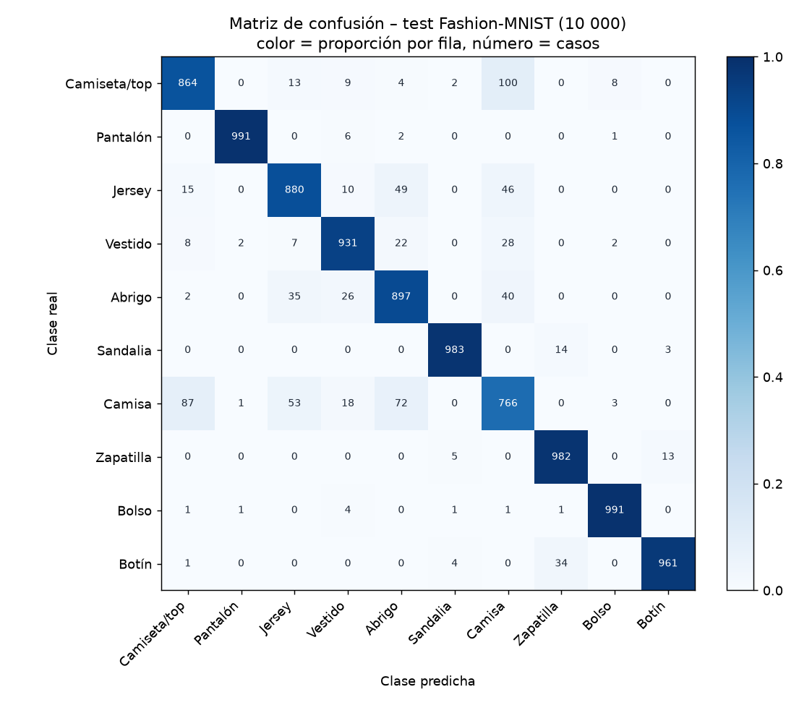
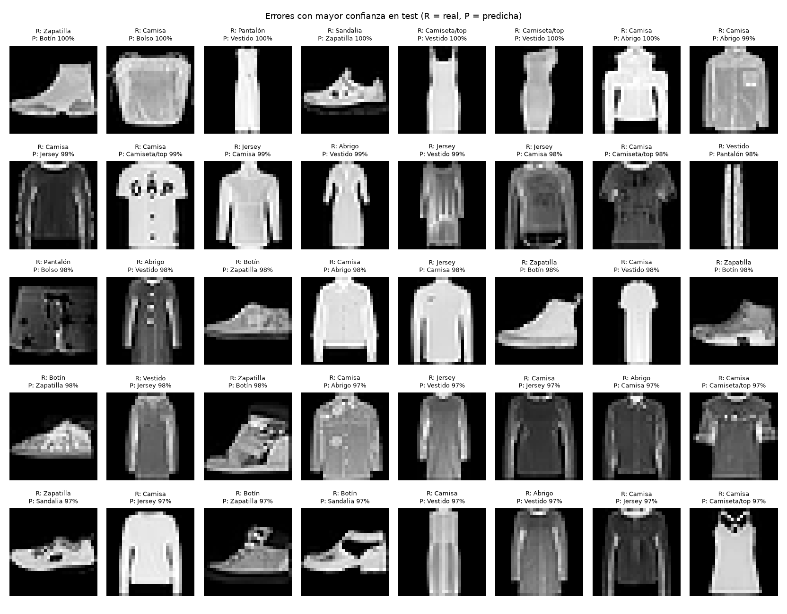
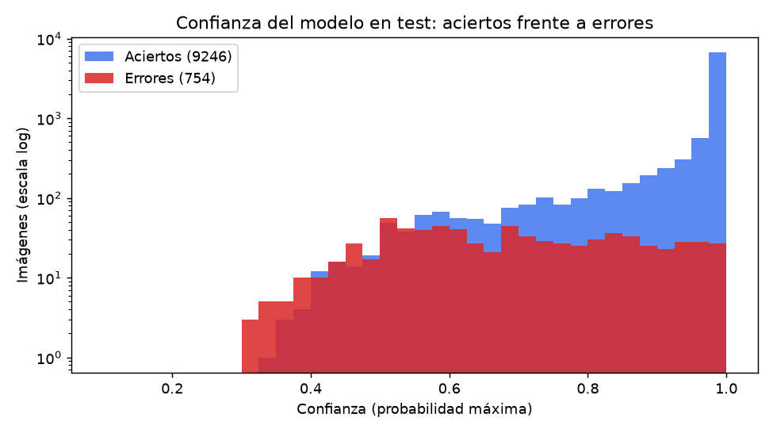

# Evaluación del clasificador de productos por imagen (CNN · Fashion-MNIST)

> Evaluación histórica del artefacto publicado originalmente. Las cifras de robustez de esta página
> no se atribuyen a candidatos nuevos; consulta [la auditoría de activación](auditoria_final_modulos.md).

**Ejecución:** 23 de noviembre de 2026.  
**Dictamen:** cumple el objetivo académico (**accuracy en test 92,46 % ≥ 91 %**). Con el preprocesado del backend, que recorta
la imagen a la prenda, mantiene **90–92 %** con fotos simuladas de catálogo, encuadre amplio y fondo gris con ruido (antes
del recorte: 15–37 % con encuadre amplio). Sigue limitado a siluetas de prendas sobre fondo liso (sección 6).

Resultados históricos: [resultados_clasificacion_productos/metricas.json](resultados_clasificacion_productos/metricas.json)
(evaluación, umbrales, robustez). El archivo [clasificacion_productos_metricas.json](clasificacion_productos_metricas.json)
identifica el entrenamiento de la versión para la demo. Reproducción del protocolo:

```bash
python -m ml.train_products --threads 4 --output candidatos/product_cnn.pt --metrics candidatos/productos.json
python -m ml.evaluate_products --out candidatos/robustez  # evalúa el modelo que esté instalado
```

## 1. Datos y protocolo

- **Dataset:** Fashion-MNIST (Zalando Research, 2017; licencia MIT; Xiao, Rasul y Vollgraf, arXiv:1708.07747). 70 000 imágenes
  en gris de 28×28 px de productos del catálogo de Zalando, 10 clases equilibradas. Se descarga con torchvision en `data/fashion_mnist/`.
- **Particiones:** del train oficial (60 000) se separa una **validación estratificada de 6 000** (semilla 42); quedan 54 000 para
  entrenar. El **test oficial (10 000)** se evalúa una sola vez, con el modelo ya elegido.
- **Selección:** la mejor época se elige solo por accuracy de validación (early stopping, paciencia 4). Los umbrales de confianza
  también se fijan en validación. Test no interviene en ninguna decisión.
- **Modelo:** CNN de dos bloques `Conv-BN-ReLU-MaxPool` (32 y 64 filtros), `Dropout(0,3)`, `FC(128)`, `FC(10)`; 421 834 parámetros.
- **Entrenamiento:** Adam (lr 1e-3), lote 128, `ReduceLROnPlateau` (factor 0,5), máximo 20 épocas. Aumento de datos: volteo
  horizontal y `RandomAffine` (traslación ±8 %, escala 0,9–1,1). Normalización media 0,2860 / desviación 0,3530.
- **Artefacto:** TorchScript (`product_cnn.pt`, sha256 `44aca288…`). Al exportar se verifica que el modelo recargado reproduce las
  salidas; la evaluación comprueba que el hash coincide con el del entrenamiento.
- **Entorno:** CPU AMD Ryzen 5 3600, torch 2.15.0+cpu; ~45 s por época.

## 2. Resultados

| Métrica | Valor |
|---|---:|
| Mejor época (de 20) | 20 |
| Accuracy validación (6 000) | 92,77 % |
| **Accuracy test (10 000)** | **92,46 %** |
| F1 macro test | 0,9245 |

La mejor época fue la última y la validación seguía mejorando lentamente: más épocas podrían aportar unas décimas.

| Clase | Precision | Recall | F1 |
|---|---:|---:|---:|
| Pantalón | 0,996 | 0,991 | 0,994 |
| Bolso | 0,986 | 0,991 | 0,989 |
| Sandalia | 0,988 | 0,983 | 0,986 |
| Botín | 0,984 | 0,961 | 0,972 |
| Zapatilla | 0,953 | 0,982 | 0,967 |
| Vestido | 0,927 | 0,931 | 0,929 |
| Jersey | 0,891 | 0,880 | 0,885 |
| Abrigo | 0,858 | 0,897 | 0,877 |
| Camiseta/top | 0,883 | 0,864 | 0,874 |
| **Camisa** | **0,781** | **0,766** | **0,773** |



## 3. Análisis de errores

Los errores se concentran en **prendas de torso**, cuya silueta a 28×28 apenas difiere:

| Real → predicha | Casos (test) |
|---|---:|
| Camiseta/top → Camisa | 100 |
| Camisa → Camiseta/top | 87 |
| Camisa → Abrigo | 72 |
| Camisa → Jersey | 53 |
| Jersey → Abrigo | 49 |
| Jersey → Camisa | 46 |

El calzado forma un segundo grupo menor (botín → zapatilla 34, sandalia → zapatilla 14). Pantalón y bolso casi no se confunden.

En los errores con mayor confianza (figura) aparecen además **etiquetas dudosas del propio dataset**: imágenes etiquetadas como
camisa que parecen un bolso, o como pantalón que parecen un vestido. Parte del error residual es ruido de etiquetado, no del modelo.



## 4. Confianza y umbral de aviso

La confianza media es 0,949 en aciertos y 0,688 en errores, pero hay errores con confianza cercana a 1. **La confianza no es una
probabilidad calibrada de acierto**; sirve para ordenar casos dudosos.



Tabla calculada **en validación** (6 000). *Cobertura* = predicciones sin aviso; *errores marcados* = proporción de errores que
quedarían señalados como baja confianza.

| Umbral | Cobertura | Accuracy sin aviso | Accuracy con aviso | Errores marcados |
|---:|---:|---:|---:|---:|
| 0,5 | 98,1 % | 93,8 % | 39,3 % | 15,7 % |
| 0,6 | 94,5 % | 95,4 % | 47,7 % | 39,6 % |
| **0,7** | **90,1 %** | **97,1 %** | **53,7 %** | **63,4 %** |
| 0,8 | 86,2 % | 98,0 % | 60,0 % | 76,5 % |
| 0,9 | 79,8 % | 99,1 % | 67,9 % | 89,6 % |

**Decisión:** umbral **0,7** para el aviso de baja confianza. Con él, el 90 % de las predicciones salen sin aviso con
97 % de acierto, y se señalan casi dos tercios de los errores. La API lo expone como `baja_confianza` y `umbral_confianza`
(configurable con la variable de entorno `PRODUCT_CONFIDENCE_THRESHOLD`).

## 5. Robustez del pipeline del backend

Se pasaron 2 000 imágenes de test por `app.services.product_service.preprocess` (el mismo código que usa la API), simulando fotos.
Se comparan el preprocesado original (rama `main`) y el actual, con el mismo modelo y las mismas imágenes:

| Escenario | Antes | **Ahora** |
|---|---:|---:|
| Original 28 px, fondo negro | 92,75 % | **92,70 %** |
| Catálogo: 280 px, RGB, fondo blanco, JPEG | 91,55 % | **92,00 %** |
| Encuadre amplio: la prenda ocupa el 50 % del lado | 37,40 % | **92,05 %** |
| Encuadre amplio: la prenda ocupa el 33 % del lado | 15,20 % | **92,45 %** |
| Fondo gris (215) con ruido gaussiano, prenda al 50 % | 17,50 % | **90,20 %** |

**Antes**, el preprocesado reducía la imagen completa a 28×28: si la prenda no llenaba el encuadre quedaba diminuta y el
rendimiento caía casi al azar, en el peor caso **con confianza alta (0,78)**, de modo que el umbral de confianza no lo detectaba.

**Ahora** el preprocesado replica cómo se construyó Fashion-MNIST (producto recortado, lado mayor escalado a 28 px y centrado):

1. Corrige la orientación EXIF (fotos de móvil) y compone la transparencia sobre fondo blanco.
2. Estima el fondo con los bordes; si es claro invierte la imagen, y resta el nivel del fondo para dejarlo en negro.
3. Recorta al cuadro de la prenda (píxeles que difieren más de 30 niveles del fondo; filas o columnas con menos del 1 %
   de esos píxeles se tratan como ruido), lo rellena a cuadrado y lo escala a 28×28.
4. Si no distingue ninguna prenda del fondo (imagen lisa, en blanco), la API responde **422** en lugar de inventar una categoría.

Las imágenes ya centradas no pierden accuracy. Los escenarios son sintéticos (prendas de Fashion-MNIST sobre fondos
controlados): demuestran que el recorte funciona, no que el modelo generalice a fotos reales arbitrarias.

## 6. Limitaciones

- **Brecha de dominio:** el modelo solo conoce siluetas en gris de 28×28 sobre fondo uniforme. Fotos con fondos con
  textura, personas, varias prendas, sombras o iluminación irregular no están representadas en los datos; con ellas el
  recorte puede abarcar más que la prenda y la clasificación degradarse.
- **Conjunto cerrado:** siempre responde con una de las 10 clases; un objeto ajeno (un móvil, un mueble) recibirá una categoría
  de ropa, a veces con confianza alta.
- **Camisa** es la clase débil (F1 0,77); la distinción entre prendas de torso es intrínsecamente difícil a esta resolución.
- **TorchScript** (`torch.jit`) está marcado como obsoleto en PyTorch 2.15; funciona, pero conviene migrar a `state_dict` o
  `torch.export` en el futuro.
- Una sola semilla: no se midió la variabilidad entre entrenamientos.
