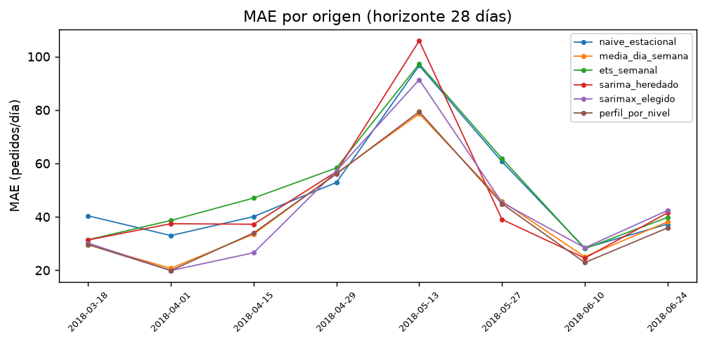
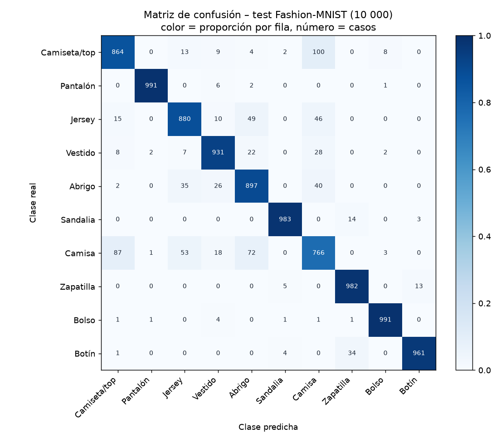

# Informe técnico – CommerceAI

> Plantilla con los apartados exigidos por el enunciado. Completar en cada sección.

## 1. Descripción de funcionalidades de la aplicación
- Panel general
- Predicción del riesgo de retraso
- Pronóstico de demanda
- Clasificación de productos por imagen
- Segmentación de vendedores
- Resumen de reseñas

## 2. Arquitectura del software inteligente
### 2.1 Visión general (diagrama de capas)
### 2.2 Frontend (React + TypeScript)
### 2.3 Backend / API (FastAPI)
### 2.4 Componentes de IA
#### 2.4.1 Predicción de retraso – datos, variables, modelo, métricas (ROC-AUC, F1)
#### 2.4.2 Series temporales – serie diaria, perfil semanal calibrado, validación (MAE, MASE, cobertura)

**Problema.** Un operador logístico necesita saber cuántos pedidos entrarán cada día de las próximas semanas para
dimensionar almacén, personal de preparación y contratación de transporte. Un número suelto no sirve para eso: hace
falta un rango con una probabilidad asociada, porque dimensionar al valor central deja corto la mitad de los días.

**Datos.** Serie diaria de **pedidos creados** a partir de `order_purchase_timestamp` de Olist, de cualquier estado.
Filtrar por entregados introduciría sesgo de supervivencia: un pedido cancelado también fue demanda.

**La ventana no se fija a mano.** La serie completa son 774 días con 140 sin ningún registro, y el archivo no termina
de golpe sino que se agota: desde el 2018-08-22 los conteos caen 187, 144, 99, 69, 67, 44, 14, 4, 1, 0 cuando el nivel
de agosto era 250-320. Dos reglas la recortan: un *hueco de cobertura* es una racha de días sin pedidos (un cero
rodeado de actividad no es demanda nula), y la *cola truncada* se detecta por caída de la media móvil de 7 días,
retrocediendo después hasta el comienzo del descenso. Resultado: **2017-01-05 a 2018-08-18, 591 días, 97.687 pedidos y
ningún cero**. El recorte importa: con la cola dentro, el error del tramo de prueba subía de 41 a 78 pedidos/día
porque el modelo "predecía" una caída que era de recolección y no de demanda.

**Modelo: perfil semanal × nivel reciente.** La demanda prevista para un día es

> *forma del día de la semana* × *nivel reciente*

donde la **forma** es la media de ese día de la semana en las últimas 12 semanas, normalizada por la media del
período, y el **nivel** es la media de los últimos 28 días. Son ocho números —siete factores y un nivel— y no hay
optimizador.

| Día | Lun | Mar | Mié | Jue | Vie | Sáb | Dom |
|---|---:|---:|---:|---:|---:|---:|---:|
| Factor de forma | 1,150 | 1,121 | 1,125 | 1,066 | 0,951 | 0,763 | 0,824 |

**Cómo se llegó a ese modelo, y por qué no es un SARIMA.** El componente nació con un SARIMAX, y su especificación se
eligió recorriendo 288 combinaciones (órdenes hasta 2, estacionalidad semanal, escala bruta o logarítmica, con y sin
exógenas de calendario), con el AIC filtrando dentro de cada familia y el backtesting decidiendo entre ellas. El mejor
SARIMAX obtuvo un MAE relativo de 0,866. Un banco posterior de **dieciocho algoritmos** —Theta, Holt-Winters
amortiguado, STL + ARIMA, regresión armónica, Ridge y gradient boosting sobre calendario, y seis variantes de perfil
semanal— midió que toda la familia del perfil pronostica mejor, y el protocolo de selección, al incorporarla como
candidata, la elige. El diagnóstico que lo explica: el error del SARIMAX era en una quinta parte error de **nivel**, y
su sesgo crecía de +1,5 pedidos/día en la primera semana del horizonte a +35,6 en la cuarta, porque extrapolaba una
tendencia que no se sostiene.

**Validación** (`ml/evaluate_demand.py`): ocho orígenes móviles con ventana expansiva, horizonte de 28 días y paso de
14 (224 días evaluados), más un tramo reservado de 28 días. El baseline obligatorio es **repetir la última semana**,
que es exactamente lo que hace la aplicación sin modelo entrenado.

| Modelo | MAE | MASE | relMAE | Gana a / 8 |
|---|---:|---:|---:|---:|
| **Perfil semanal × nivel** (activo) | **40,33** | **1,224** | **0,822** | **7** |
| Media por día de la semana, 4 semanas | 40,98 | 1,243 | 0,842 | 6 |
| SARIMA(2,1,2)(1,1,1)[7] + calendario | 42,68 | 1,294 | 0,866 | 5 |
| SARIMA(1,1,1)(1,0,1)[7] | 46,75 | 1,420 | 0,954 | 4 |
| *Repetir la última semana (baseline)* | 48,67 | 1,476 | 1,000 | 0 |
| Holt-Winters aditivo | 50,31 | 1,526 | 1,039 | 2 |

**La banda no sale del modelo, sale de los errores medidos.** Una media agrupada no es un modelo probabilístico y no
tiene intervalo teórico; tampoco servía el del SARIMAX, que prometía un 80 % y cubría un 62 %. El intervalo se
construye con los cuantiles empíricos del error relativo observado en el backtesting, por bloques semanales del
horizonte (6 orígenes, 90 días, 13 bloques). Se ensancha con el horizonte porque los errores se ensanchan y es
asimétrico porque los errores lo son. **Cobertura medida en los ocho orígenes: 86,2 %** frente al 80 % nominal.

**Resultados en el tramo reservado** (2018-07-22 a 2018-08-18): MAE 82,79, relMAE 1,668, cobertura 32,1 %. **El
componente no pasa su criterio de aceptación completo**, y la razón está medida: esa ventana contiene un salto de
nivel del **+44 %** —julio promedia 203 pedidos/día y los dieciocho primeros días de agosto, 284— mientras que el
mayor salto en los datos de calibración fue del +12,6 %. Ninguna banda construida con el pasado podía cubrirlo. El
SARIMAX lo hizo mejor en esa ventana concreta porque su sesgo sistemático al alza apuntaba por casualidad en la
dirección correcta.

**Integración en la aplicación.** `GET /api/demand/forecast?horizonte=&historico=&nivel=` devuelve el histórico
reciente y el pronóstico; cada punto futuro lleva `inferior` y `superior`, y la respuesta incluye el modelo, el ancla
temporal, la ventana de entrenamiento y las métricas medidas. El horizonte está acotado a **90 días** porque la
ventana cubre 84 semanas y ningún ciclo anual completo. El artefacto son 28,6 KB; el ajuste tarda **0,65 ms** frente a
los 1,8 s del SARIMAX, y una petición de 90 días se resuelve en **21 ms**. El entrenamiento comprueba que el artefacto
recargado reproduce su propio pronóstico antes de activarlo (desvío 0,00e+00). Si el artefacto falta o es
incompatible, la API **no devuelve un 500**: cae a repetir la última semana y lo declara en pantalla.

**Limitaciones.** La banda describe la variación habitual, no un cambio de régimen: está calibrada con saltos de nivel
de hasta ±25 %. El modelo no tiene dinámica y deja mucha autocorrelación sin explotar (Ljung-Box p < 0,001 en los
retardos 7, 14 y 28), aunque los modelos que intentan capturarla pronostican peor a 28 días. No mira el calendario,
así que no sabe nada de festivos ni del Black Friday, que además ocurre una sola vez en la serie. Análisis completo:
`docs/evaluacion_demanda.md` y `docs/algoritmos_demanda.md`.

**Pruebas.** `ml/tests/test_demand.py` (32 casos: construcción de la serie, reglas de ventana, baselines, ausencia de
fuga entre orígenes, métricas y calendario), `ml/tests/test_demand_api.py` (41 casos: las dos familias de modelo,
artefacto, banda calibrada, contrato HTTP y degradación) y `ml/tests/test_demand_benchmark.py` (13 casos: contrato de
los algoritmos y honestidad del banco). Ninguna optimiza un SARIMAX. En el frontend, pruebas E2E de la pantalla en
cuatro tamaños con auditoría de accesibilidad.

#### 2.4.3 Clasificación de imágenes – CNN, Fashion-MNIST, accuracy, matriz de confusión

**Problema.** En un marketplace, cada vendedor publica productos con una categoría que a menudo falta o es incorrecta.
El componente propone automáticamente la categoría de un producto a partir de su foto, para agilizar el alta en el
catálogo y detectar productos mal categorizados.

**Datos.** Fashion-MNIST (ver §2.5): 70 000 imágenes en gris de 28 × 28 px de productos de Zalando, en 10 categorías
equilibradas: camiseta/top, pantalón, jersey, vestido, abrigo, sandalia, camisa, zapatilla, bolso y botín.

**Modelo.** Red neuronal convolucional (CNN) implementada en PyTorch:

| Capa | Salida | Función |
|---|---|---|
| Entrada | 1 × 28 × 28 | Imagen en gris normalizada (media 0,2860, desviación 0,3530) |
| Conv 3×3 (32) + BatchNorm + ReLU + MaxPool | 32 × 14 × 14 | Bordes y texturas |
| Conv 3×3 (64) + BatchNorm + ReLU + MaxPool | 64 × 7 × 7 | Formas: mangas, cuellos, suelas, asas |
| Flatten + Dropout (0,3) + Dense (128) + ReLU | 128 | Combinación de rasgos; el dropout reduce el sobreajuste |
| Dense (10) + softmax | 10 | Probabilidad de cada categoría |

En total, 421 834 parámetros entrenables. La arquitectura es deliberadamente compacta: entrena en CPU en ~15 min y clasifica
una imagen en ~2 ms (preprocesado incluido, CPU Ryzen 5 3600), suficiente para la resolución de 28 × 28 px.

**Entrenamiento y validación** (`ml/train_products.py`):

- Del conjunto oficial de entrenamiento (60 000) se separa una **validación estratificada de 6 000** imágenes (semilla 42).
  El **test oficial (10 000)** solo se usa una vez, al final, para que la métrica publicada no esté sesgada.
- Optimizador Adam (tasa 0,001, lote 128), con reducción de la tasa a la mitad cuando la validación se estanca.
  **Early stopping**: se conserva la época con mejor accuracy de validación (máximo 20; paciencia 4).
- Aumento de datos: volteo horizontal y pequeñas traslaciones y cambios de escala, para tolerar prendas no centradas.
- El modelo se exporta como TorchScript (`backend/app/models/product_cnn.pt`), con verificación de que el archivo recargado
  reproduce las predicciones. Protocolo, historial y métricas: `docs/clasificacion_productos_metricas.json`.

**Resultados en test** (10 000 imágenes no vistas):

| Métrica | Valor |
|---|---:|
| **Accuracy** | **92,46 %** (objetivo ≥ 91 %) |
| F1 macro | 0,924 |
| Accuracy en validación (época 20 de 20) | 92,77 % |

Las mejores categorías son pantalón (F1 0,994), bolso (0,989) y sandalia (0,986). La más difícil es **camisa** (F1 0,773):
la matriz de confusión muestra que los errores se concentran entre prendas de torso, cuya silueta a 28 × 28 px apenas
difiere (camiseta → camisa: 100 casos; camisa → camiseta: 87; camisa → abrigo: 72). Entre los errores con más confianza
aparecen además etiquetas dudosas del propio dataset.

**Confianza y aviso de revisión.** La probabilidad máxima no está calibrada, pero ordena bien los casos dudosos (confianza
media 0,949 en aciertos frente a 0,688 en errores). Con un umbral de **0,7, elegido en validación**, el 90 % de las
predicciones se muestran sin aviso con un 97 % de acierto, y el resto se marca para revisión manual; así se señalan casi dos
tercios de los errores.

**Integración en la aplicación.** El endpoint `POST /api/products/classify` recibe la imagen (multipart, campo `imagen`,
hasta 5 MB) y devuelve la categoría, la confianza, las tres categorías más probables y el indicador `baja_confianza`.
Antes de clasificar, `product_service.preprocess` adapta cualquier foto al formato de Fashion-MNIST:

1. Corrige la orientación EXIF, compone la transparencia sobre blanco y convierte a escala de grises.
2. Estima el fondo con los bordes de la imagen; si es claro la invierte (Fashion-MNIST usa prenda clara sobre negro).
3. **Recorta la imagen a la prenda**, la rellena a cuadrado y la escala a 28 × 28 px, igual que se construyó el dataset.

Los archivos que no son imágenes o están dañados se rechazan (400), igual que los que superan el tamaño (413). Si no se
distingue ninguna prenda (imagen lisa), la API responde 422 en lugar de inventar una categoría.

**Robustez.** El recorte fue decisivo. Con 2 000 imágenes de test simuladas como fotos (`ml/evaluate_products.py`):

| Escenario | Sin recorte | Con recorte |
|---|---:|---:|
| Foto de catálogo: 280 px, color, fondo blanco | 91,6 % | 92,0 % |
| Prenda ocupando el 33 % del encuadre | 15,2 % | 92,5 % |
| Fondo gris con ruido, prenda al 50 % | 17,5 % | 90,2 % |

**Limitaciones.** El modelo solo conoce siluetas en gris sobre fondo uniforme: fotos con fondos con textura, personas o
varias prendas degradan el resultado. Es un clasificador de conjunto cerrado (cualquier objeto recibe una de las 10
categorías) y no distingue detalles finos como colores o estampados. Análisis completo: `docs/evaluacion_productos.md`.

**Pruebas.** `ml/tests/test_products.py` (24 pruebas: preprocesado, servicio, API, coherencia con el entrenamiento y
modelo real) y pruebas E2E con Playwright de la página de clasificación en cuatro tamaños de pantalla, con auditoría de
accesibilidad.

#### 2.4.4 Clustering – métricas por vendedor, K-Means, elección de k (codo, silhouette)
#### 2.4.5 Resumen de texto – TextRank, ejemplos de resúmenes
### 2.5 Datos (Olist, Fashion-MNIST)

#### Olist – serie diaria de demanda

| | |
|---|---|
| Origen | Olist Store (2018). *Brazilian E-Commerce Public Dataset by Olist*, Kaggle |
| Licencia | CC BY-NC-SA 4.0 |
| Fichero usado | `olist_orders_dataset.csv` (99.441 pedidos), SHA-256 `8df58ef3…9ecf` |
| Período del archivo | Compras del 2016-09-04 al 2018-10-17; 774 días, 140 sin registros |
| Serie construida | Pedidos creados por día calendario, cualquier estado |
| Ventana utilizada | 2017-01-05 a 2018-08-18: 591 días, 97.687 pedidos, ningún día a cero |
| Partición | 8 orígenes de desarrollo (224 días) + 28 días reservados; calibración sobre 6 orígenes de 90 días |

La ventana se obtiene por regla y no por fechas escritas a mano: se descartan los huecos de cobertura de 2016 y de
comienzos de 2017, y el descenso final del archivo a partir del 2018-08-19 (§2.4.2).

#### Fashion-MNIST

| | |
|---|---|
| Origen | Zalando Research (2017). Xiao, H., Rasul, K. y Vollgraf, R. *Fashion-MNIST: a Novel Image Dataset for Benchmarking Machine Learning Algorithms*. arXiv:1708.07747 |
| Licencia | MIT |
| Contenido | 70 000 imágenes de productos del catálogo de Zalando: 60 000 de entrenamiento y 10 000 de test |
| Formato | 28 × 28 px, escala de grises (0–255), producto claro y centrado sobre fondo negro |
| Clases | 10, equilibradas (7 000 imágenes cada una) |
| Obtención | Descarga automática con `torchvision.datasets.FashionMNIST` en `data/fashion_mnist/` (~30 MB, excluido de git) |
| Uso en el proyecto | Componente 3: 54 000 entrenamiento / 6 000 validación (estratificada) / 10 000 test |

Cada imagen se creó recortando la foto original del producto, escalando su lado mayor a 28 px y centrándola; el
preprocesado del backend reproduce ese proceso con las fotos que suben los usuarios (§2.4.3).

## 3. Tipo de población que puede usar el software
- Empresas de e-commerce y marketplaces
- Operadores logísticos
- Vendedores (pymes)
- Instituciones / gobierno (análisis del comercio electrónico regional)

## 4. Ventajas frente a otros softwares existentes

## 5. Conclusiones y trabajo futuro
