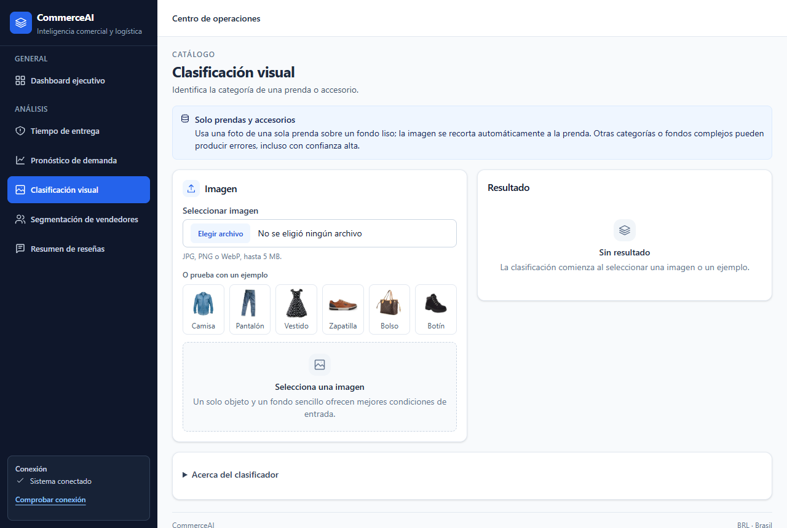
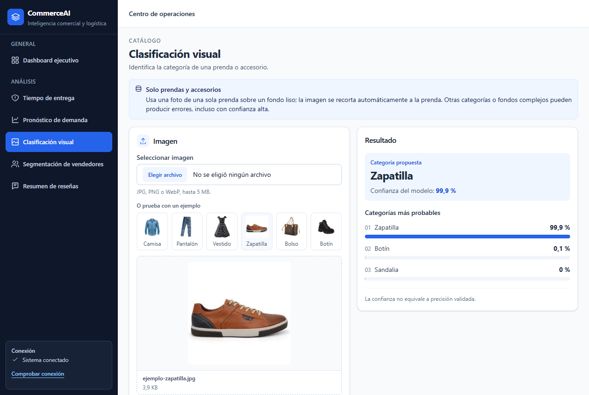
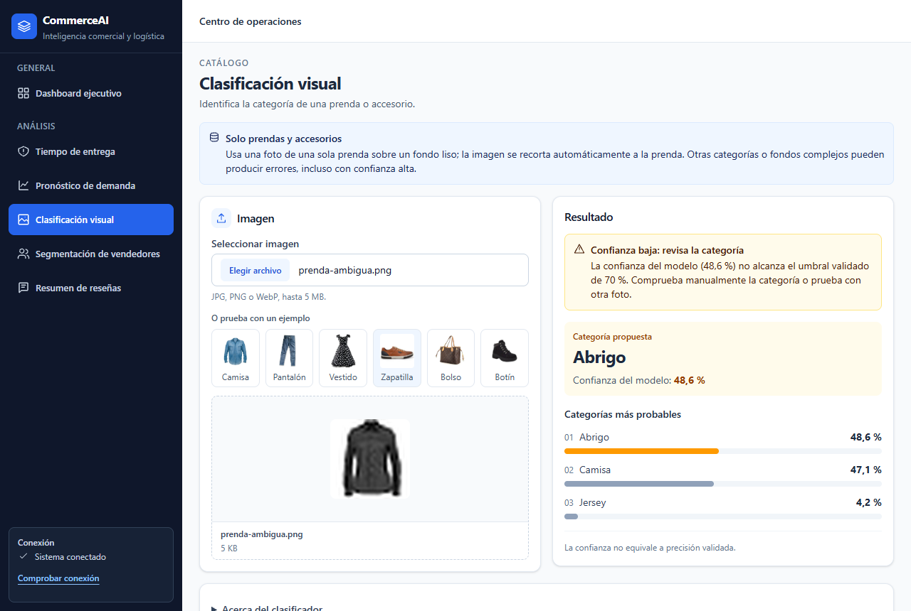
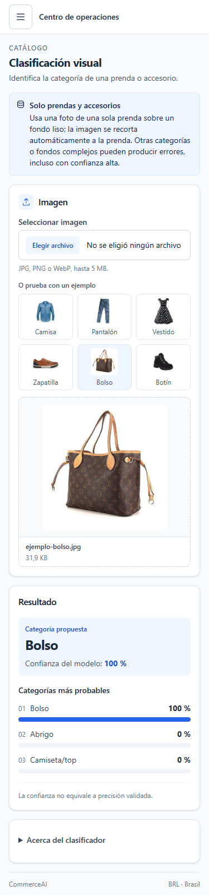

# Manual de usuario – CommerceAI

> Plantilla. Una sección por pantalla, con capturas y ejemplo de uso.

## 1. Panel general
## 2. Riesgo de retraso
## 3. Demanda de pedidos
## 4. Clasificación de productos

**Para qué sirve:** proponer la categoría de una prenda o accesorio a partir de su foto, por ejemplo al dar de alta un
producto en el catálogo o para revisar productos mal categorizados.

**Dónde:** menú lateral → **Clasificación visual** (ruta `/productos`).

### Cómo se usa

1. Pulsa **Elegir archivo** y selecciona una foto (JPG, PNG o WebP, hasta 5 MB).
   También puedes pulsar uno de los **ejemplos** (camisa, pantalón, vestido, zapatilla, bolso o botín), que son fotos
   reales de producto, para probar sin tener una foto a mano.
2. La clasificación empieza sola. A la izquierda verás la imagen elegida y, a la derecha, el resultado.

### Cómo leer el resultado

- **Categoría propuesta:** la categoría más probable según el modelo.
- **Confianza del modelo:** probabilidad que el modelo asigna a esa categoría. Es una guía, no una garantía de acierto.
- **Categorías más probables:** las tres opciones con mayor probabilidad. Si la segunda está cerca de la primera, el
  modelo duda entre ambas.

El clasificador reconoce **10 categorías**: camiseta/top, pantalón, jersey, vestido, abrigo, sandalia, camisa, zapatilla,
bolso y botín. Acierta el 92,5 % de las imágenes de prueba; la categoría más difícil es **camisa**, que puede confundirse
con camiseta, jersey o abrigo.

### Avisos y errores

| Lo que ves | Qué significa | Qué hacer |
|---|---|---|
| Aviso amarillo **"Confianza baja: revisa la categoría"** | La confianza es inferior al 70 %: el modelo no está seguro | Comprueba la categoría a mano o prueba con otra foto |
| **"No se distingue ninguna prenda del fondo"** | La imagen es lisa o la prenda no contrasta con el fondo | Usa una foto con la prenda visible sobre un fondo liso |
| **"El archivo no es una imagen válida o está dañado"** | El archivo no se puede abrir como imagen | Vuelve a exportar la foto en JPG o PNG |
| **"La imagen supera el máximo de 5 MB"** | El archivo es demasiado grande | Reduce la resolución de la foto |
| **"Clasificación no disponible"** | El modelo todavía no está entrenado en el servidor | Avisa al administrador (ver manual de instalación, §4) |

### Consejos para obtener buenos resultados

- **Una sola prenda por foto**, completa y sin cortar.
- **Fondo liso** (pared, mesa o suelo de un solo color). No hace falta que la prenda llene la foto: la imagen se
  recorta automáticamente a la prenda.
- Evita fotos con personas, maniquíes, sombras fuertes o varias prendas.
- Objetos que no son de las 10 categorías (gorras, relojes, gafas…) siempre recibirán una de ellas: no tienen sentido.

En el móvil, el resultado aparece debajo de la imagen.

## 5. Segmentación de vendedores
## 6. Resumen de reseñas
