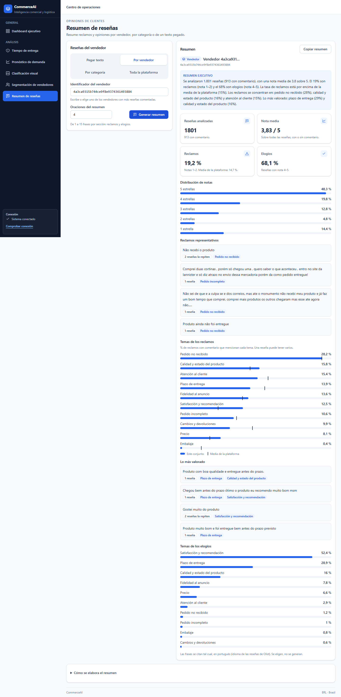
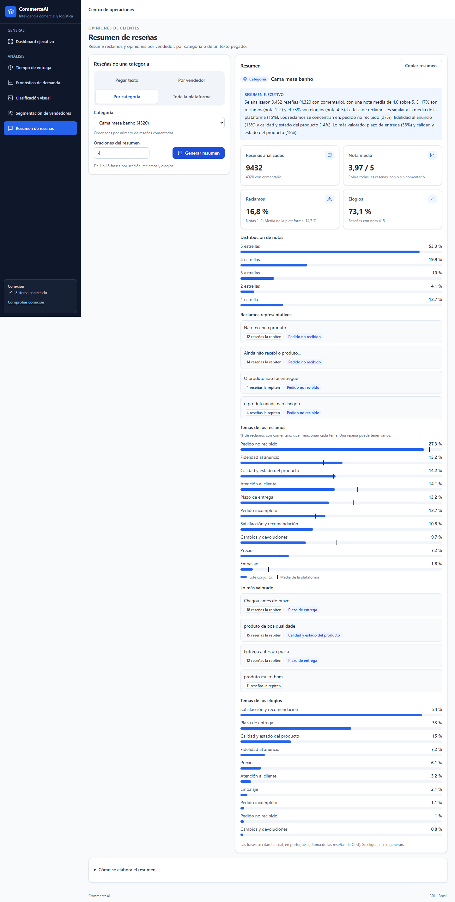
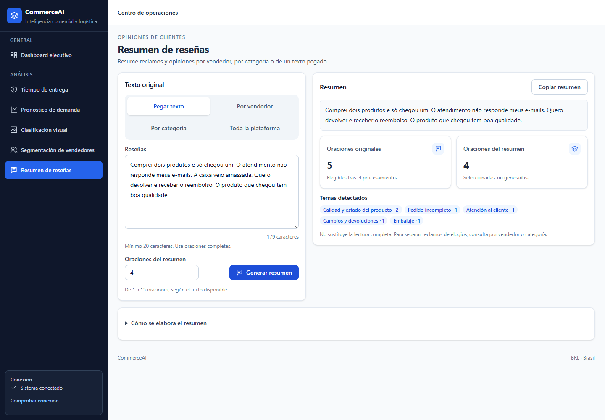
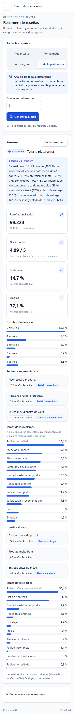

# Manual de usuario – CommerceAI

> Plantilla. Una sección por pantalla, con capturas y ejemplo de uso.

## 1. Panel general
## 2. Riesgo de retraso
## 3. Demanda de pedidos
## 4. Clasificación de productos

**Para qué sirve:** proponer la categoría de una prenda o accesorio a partir de su foto, por ejemplo al dar de alta un
producto en el catálogo o para revisar productos mal categorizados.

**Dónde:** menú lateral → **Clasificación visual** (ruta `/productos`).

### Cómo se usa

1. Pulsa **Elegir archivo** y selecciona una foto (JPG, PNG o WebP, hasta 5 MB).
   También puedes pulsar uno de los **ejemplos** (camisa, pantalón, vestido, zapatilla, bolso o botín), que son fotos
   reales de producto, para probar sin tener una foto a mano.
2. La clasificación empieza sola. A la izquierda verás la imagen elegida y, a la derecha, el resultado.

### Cómo leer el resultado

- **Categoría propuesta:** la categoría más probable según el modelo.
- **Confianza del modelo:** probabilidad que el modelo asigna a esa categoría. Es una guía, no una garantía de acierto.
- **Categorías más probables:** las tres opciones con mayor probabilidad. Si la segunda está cerca de la primera, el
  modelo duda entre ambas.

El clasificador reconoce **10 categorías**: camiseta/top, pantalón, jersey, vestido, abrigo, sandalia, camisa, zapatilla,
bolso y botín. Acierta el 92,5 % de las imágenes de prueba; la categoría más difícil es **camisa**, que puede confundirse
con camiseta, jersey o abrigo.

### Avisos y errores

| Lo que ves | Qué significa | Qué hacer |
|---|---|---|
| Aviso amarillo **"Confianza baja: revisa la categoría"** | La confianza es inferior al 70 %: el modelo no está seguro | Comprueba la categoría a mano o prueba con otra foto |
| **"No se distingue ninguna prenda del fondo"** | La imagen es lisa o la prenda no contrasta con el fondo | Usa una foto con la prenda visible sobre un fondo liso |
| **"El archivo no es una imagen válida o está dañado"** | El archivo no se puede abrir como imagen | Vuelve a exportar la foto en JPG o PNG |
| **"La imagen supera el máximo de 5 MB"** | El archivo es demasiado grande | Reduce la resolución de la foto |
| **"Clasificación no disponible"** | El modelo todavía no está entrenado en el servidor | Avisa al administrador (ver manual de instalación, §4) |

### Consejos para obtener buenos resultados

- **Una sola prenda por foto**, completa y sin cortar.
- **Fondo liso** (pared, mesa o suelo de un solo color). No hace falta que la prenda llene la foto: la imagen se
  recorta automáticamente a la prenda.
- Evita fotos con personas, maniquíes, sombras fuertes o varias prendas.
- Objetos que no son de las 10 categorías (gorras, relojes, gafas…) siempre recibirán una de ellas: no tienen sentido.

En el móvil, el resultado aparece debajo de la imagen.

## 5. Segmentación de vendedores
## 6. Resumen de reseñas

**Para qué sirve:** saber qué reclaman y qué valoran los clientes sin leer miles de reseñas, por vendedor, por categoría
de producto o en toda la plataforma.

**Dónde:** menú lateral → **Resumen de reseñas** (ruta `/resenas`).

### Cómo se usa

1. Elige qué reseñas analizar:
   - **Por vendedor:** escribe el identificador del vendedor de Olist o elige uno de la lista desplegable (aparecen los
     30 vendedores con más reseñas comentadas, con su número de reseñas y su nota media).
   - **Por categoría:** elige una categoría de producto (ordenadas por número de reseñas).
   - **Toda la plataforma:** no hay que elegir nada. La primera consulta puede tardar unos segundos.
   - **Pegar texto:** pega reseñas propias, en español o portugués.
2. Indica cuántas frases quieres por sección en **Oraciones del resumen** (de 1 a 15).
3. Pulsa **Generar resumen**. Con **Copiar resumen** obtienes el resumen completo en texto, listo para pegar en un
   informe o un correo.

### Cómo leer el resultado

- **Resumen ejecutivo:** un párrafo en español con lo esencial: nota media, porcentaje de reclamos frente a la media de la
  plataforma, temas que más se repiten en los reclamos y lo más valorado.
- **Indicadores:** reseñas analizadas, nota media, % de reclamos (notas 1–2) y % de elogios (notas 4–5).
- **Distribución de notas:** cuántas reseñas tiene cada nota.
- **Reclamos representativos / Lo más valorado:** frases reales de los clientes, elegidas porque resumen lo que dicen
  muchos otros. Se muestran tal cual, en portugués (idioma de Olist). La etiqueta “N reseñas la repiten” indica cuántos
  clientes escribieron esa misma frase, y las etiquetas azules, sus temas.
- **Temas de los reclamos:** porcentaje de reclamos que menciona cada tema. La marca vertical negra es la media de la
  plataforma: si la barra azul la supera claramente, ese problema es más frecuente que en el resto de vendedores. Al
  pasar el cursor por una barra se ve el detalle.

**Ejemplo de uso:** si un vendedor tiene muchos reclamos de “fidelidad al anuncio” por encima de la media, conviene revisar
las fotos y descripciones de sus productos. Si destaca “pedido no recibido”, el problema está en el envío.

En el modo **Pegar texto** se obtiene un resumen con las oraciones más representativas, en su orden original, y la lista
de temas detectados.

### Avisos y errores

| Lo que ves | Qué significa | Qué hacer |
|---|---|---|
| **"Sin reseñas para ese vendedor"** | El identificador no existe o el vendedor no tiene reseñas con comentario | Revisa el identificador o elige uno de la lista |
| Aviso **"Hay pocas reseñas con comentario"** | Menos de 10 reseñas comentadas: el resumen es orientativo | Interprétalo con cautela |
| Aviso **"Reseñas no disponibles"** o **"Categorías no disponibles"** | El servidor no tiene cargados los datos de Olist | Usa **Pegar texto** o avisa al administrador (ver `data/README.md`) |
| **"Introduce al menos 20 caracteres"** | El texto pegado es demasiado corto | Pega reseñas con oraciones completas |

En el móvil, el resultado aparece debajo del formulario.

