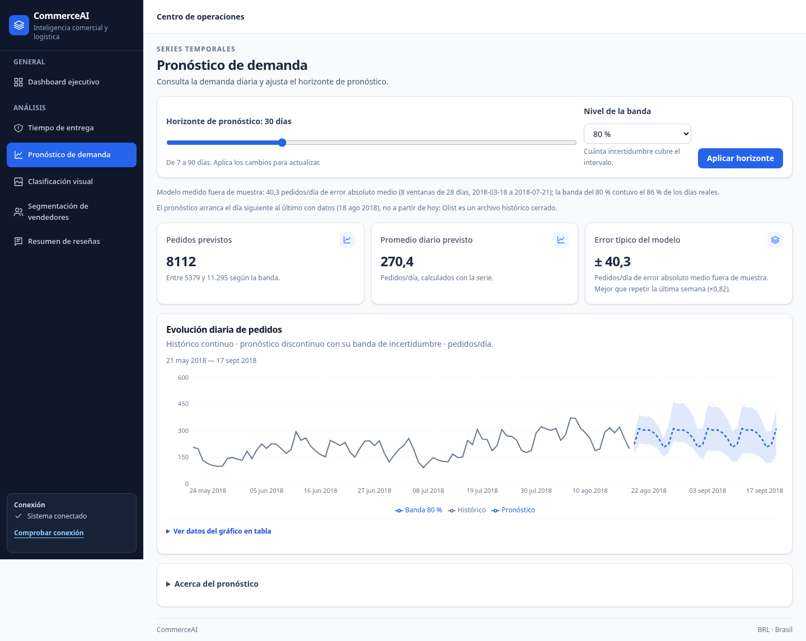
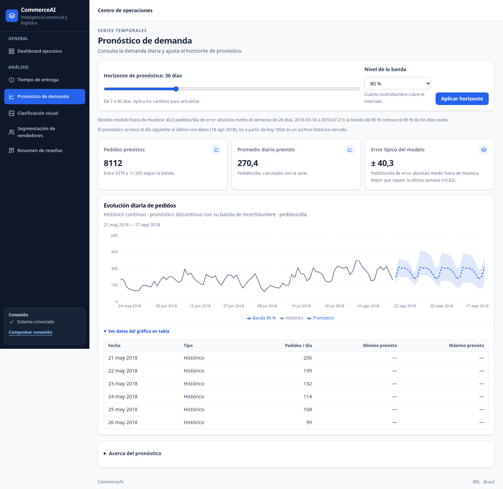
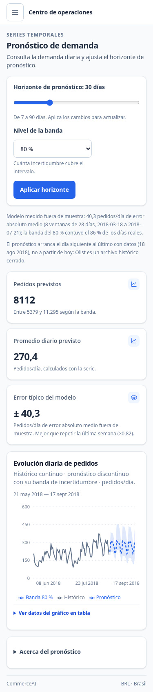
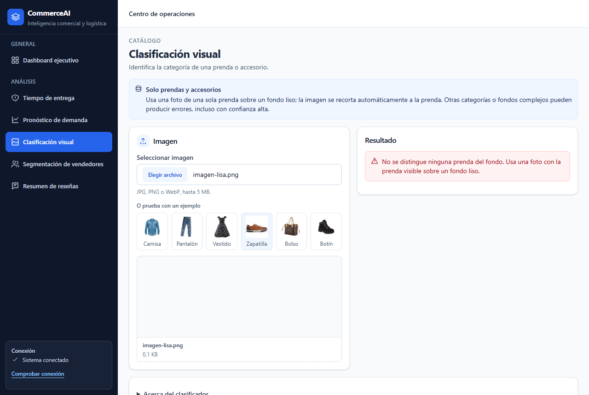

# Manual de usuario – CommerceAI

> Plantilla. Una sección por pantalla, con capturas y ejemplo de uso.

## 1. Panel general
## 2. Riesgo de retraso
## 3. Demanda de pedidos

**Para qué sirve:** anticipar cuántos pedidos entrarán cada día de las próximas semanas, para dimensionar el almacén,
el personal de preparación y la contratación de transporte.

**Dónde:** menú lateral → **Pronóstico de demanda** (ruta `/demanda`).

### Cómo se usa

1. Mueve el **deslizador de horizonte** para elegir cuántos días quieres pronosticar, entre 7 y 90.
2. Elige el **nivel de la banda**: 80 % para planificar el caso habitual, 95 % si prefieres cubrirte más.
3. Pulsa **Aplicar horizonte**. Nada se recalcula mientras arrastras el deslizador: la consulta se lanza al aplicar.

### Cómo leer el resultado

- **Pedidos previstos:** la suma del horizonte completo. Debajo aparece el rango de la banda, que es lo que conviene
  usar para planificar: *entre X e Y pedidos*.
- **Promedio diario previsto:** la misma cifra repartida por día.
- **Error típico del modelo:** cuánto se equivoca el modelo, en pedidos por día, medido sobre días que **no** usó para
  entrenar. También dice si mejora o no a la regla simple de repetir la última semana.
- **El gráfico:** la línea gris continua es el histórico real; la discontinua azul, el pronóstico; la franja azul
  alrededor es la banda de incertidumbre. **Ver datos del gráfico en tabla** abre los mismos valores en una tabla con
  el mínimo y el máximo previstos de cada día.

### Qué significa la banda

La banda del 80 % quiere decir que, en los días de prueba, el valor real cayó dentro de ella aproximadamente 8 de cada
10 veces. **No** es el mejor y el peor caso imaginables: es el rango donde cabe esperar que esté la demanda. Si
planificas con la línea central te quedarás corto la mitad de los días; si planificas con el extremo superior,
sobrarán recursos casi siempre.

### El pronóstico no empieza hoy

Olist es un **archivo histórico cerrado**: los pedidos llegan hasta agosto de 2018. Por eso el pronóstico arranca el
día siguiente al último con datos, y la pantalla lo dice explícitamente. No es un fallo ni un reloj mal puesto.

### Avisos

| Lo que ves | Qué significa | Qué hacer |
|---|---|---|
| **"Estimación orientativa · Sin modelo entrenado, se repite la última semana"** | Falta el modelo en el servidor, pero el histórico es real | Avisa al administrador (manual de instalación, §4) |
| **"Datos sintéticos · solo demostración"** | Ni modelo ni datos de Olist: la serie es inventada | No tomar ninguna decisión con esos números |
| **"Procedencia no confirmada"** | No se pudo consultar el estado del sistema | Reintenta; si persiste, avisa al administrador |

### Límites que conviene conocer

- El horizonte llega a 90 días. Más allá no se ofrece porque el histórico no cubre dos años completos y no hay
  estacionalidad anual que aprender.
- Los picos comerciales irrepetibles no se pronostican. En el histórico, el Black Friday de 2017 multiplicó por casi
  ocho la demanda de un día normal, y eso ocurrió **una sola vez**: el modelo sabe qué día cae, pero no cuánto subirá.
- El detalle completo de cómo se midió todo esto está en `docs/evaluacion_demanda.md`.

## 4. Clasificación de productos

**Para qué sirve:** proponer la categoría de una prenda o accesorio a partir de su foto, por ejemplo al dar de alta un
producto en el catálogo o para revisar productos mal categorizados.

**Dónde:** menú lateral → **Clasificación visual** (ruta `/productos`).

### Cómo se usa

1. Pulsa **Elegir archivo** y selecciona una foto (JPG, PNG o WebP, hasta 5 MB).
   También puedes pulsar uno de los **ejemplos** (camisa, pantalón, vestido, zapatilla, bolso o botín), que son fotos
   reales de producto, para probar sin tener una foto a mano.
2. La clasificación empieza sola. A la izquierda verás la imagen elegida y, a la derecha, el resultado.

### Cómo leer el resultado

- **Categoría propuesta:** la categoría más probable según el modelo.
- **Confianza del modelo:** probabilidad que el modelo asigna a esa categoría. Es una guía, no una garantía de acierto.
- **Categorías más probables:** las tres opciones con mayor probabilidad. Si la segunda está cerca de la primera, el
  modelo duda entre ambas.

El clasificador reconoce **10 categorías**: camiseta/top, pantalón, jersey, vestido, abrigo, sandalia, camisa, zapatilla,
bolso y botín. Acierta el 92,5 % de las imágenes de prueba; la categoría más difícil es **camisa**, que puede confundirse
con camiseta, jersey o abrigo.

### Avisos y errores

| Lo que ves | Qué significa | Qué hacer |
|---|---|---|
| Aviso amarillo **"Confianza baja: revisa la categoría"** | La confianza es inferior al 70 %: el modelo no está seguro | Comprueba la categoría a mano o prueba con otra foto |
| **"No se distingue ninguna prenda del fondo"** | La imagen es lisa o la prenda no contrasta con el fondo | Usa una foto con la prenda visible sobre un fondo liso |
| **"El archivo no es una imagen válida o está dañado"** | El archivo no se puede abrir como imagen | Vuelve a exportar la foto en JPG o PNG |
| **"La imagen supera el máximo de 5 MB"** | El archivo es demasiado grande | Reduce la resolución de la foto |
| **"Clasificación no disponible"** | El modelo todavía no está entrenado en el servidor | Avisa al administrador (ver manual de instalación, §4) |

### Consejos para obtener buenos resultados

- **Una sola prenda por foto**, completa y sin cortar.
- **Fondo liso** (pared, mesa o suelo de un solo color). No hace falta que la prenda llene la foto: la imagen se
  recorta automáticamente a la prenda.
- Evita fotos con personas, maniquíes, sombras fuertes o varias prendas.
- Objetos que no son de las 10 categorías (gorras, relojes, gafas…) siempre recibirán una de ellas: no tienen sentido.

En el móvil, el resultado aparece debajo de la imagen.

## 5. Segmentación de vendedores
## 6. Resumen de reseñas
